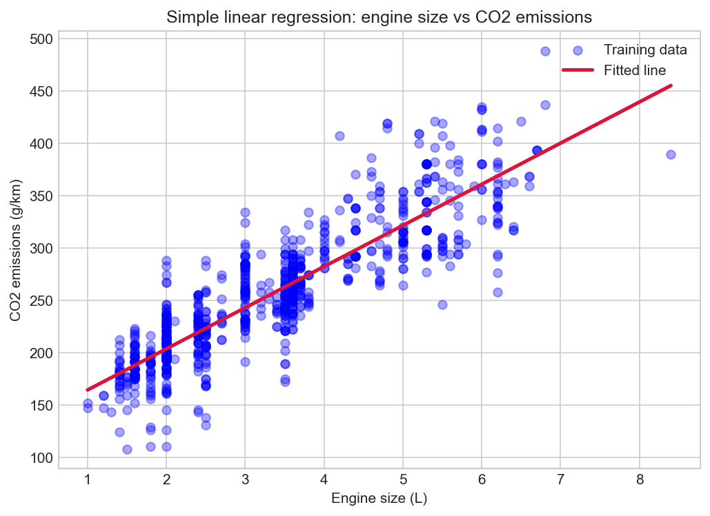

# 01 — Simple Linear Regression

> Fitting a straight line through data to predict a continuous value.

**Notebook:** [`notebook.ipynb`](notebook.ipynb) — the full working, code, and plots.

---

## What this lesson covers

Predicting a car's CO2 emissions from its engine size. One input feature, one
output, and a model restricted to a straight line — the simplest supervised
learning problem there is, which makes it the right place to work out what
"learning" actually means.

The lesson covers choosing a feature, splitting data into training and test
sets, fitting the line with scikit-learn, and measuring how well it predicts
cars it has never seen.

---

## Intuition

Plot every car as a dot — engine size across, emissions up — and the dots slope
upward rather than scattering randomly. A straight line through the middle of
that cloud captures the pattern.

There are infinitely many lines to choose from, so "best" has to be defined
before it can be found. The definition used here: the best line is the one whose
vertical distances to the dots, squared and summed, are as small as possible.
Squaring makes misses above and below count equally, and makes big misses count
disproportionately.

---

## The mathematics

**Model**

$$
\hat{y} = w x + b
$$

$w$ is the slope, in grams of CO2 per litre of engine displacement; $b$ is the
intercept.

**Cost function** — the residual sum of squares, averaged over $m$ training
cars:

$$
J(w, b) = \frac{1}{m} \sum_{i=1}^{m} \left( w x^{(i)} + b - y^{(i)} \right)^2
$$

**Finding the parameters.** $J$ is quadratic in $w$ and $b$, so it has a single
minimum and no local traps. Setting its derivatives to zero gives a system that
can be solved directly, which is what `LinearRegression.fit()` does — the answer
is exact rather than approached step by step. The consequence is that all
training rows must be available at once.

---

## The dataset

| Property | Value |
|---|---|
| **Source** | [Fuel consumption ratings, Government of Canada open data](https://open.canada.ca/data/en/dataset/98f1a129-f628-4ce4-b24d-6f16bf24dd64) |
| **Samples** | 1,067 vehicles (model year 2014) |
| **Feature used** | `ENGINESIZE` — engine displacement in litres |
| **Target** | `CO2EMISSIONS` — tailpipe CO2 in grams per kilometre |
| **Split** | 80 / 20, seeded — 859 training rows, 208 test rows |

Engine size was chosen over fuel consumption deliberately. Fuel consumption
correlates so tightly with emissions that the line becomes trivially good;
engine size has visible spread around the trend, which makes it a more honest
test of the method.

---

## What the code does

[`notebook.ipynb`](notebook.ipynb) works through the problem in seven sections:
the problem, the intuition, the mathematics, the data, modeling, results, and
reflections.

The data section loads the CSV, narrows 13 columns to the four numeric ones,
plots each candidate feature against emissions to justify the choice of engine
size, and splits the rows 80/20 using a **seeded** random generator — without
the seed, every rerun produces different coefficients and a different score.

The modeling section is a single `LinearRegression().fit()` call. The results
section draws the fitted line over the training data and then scores the model
on the held-out test set with four metrics.

---

## Results

The fitted line:

$$
\widehat{\text{CO2}} = 39.29 \times \text{engine size} + 124.94
$$

Scored on the 208 held-out test cars:

| Metric | Value |
|---|---|
| MAE | 24.43 g/km |
| MSE | 993.50 |
| RMSE | 31.52 g/km |
| R² | 0.76 |

**Reading it.** Each additional litre of engine displacement is associated with
about 39 more grams of CO2 per kilometre, and engine size alone explains roughly
76% of the variation in emissions. A typical prediction misses by around 24
g/km.

The intercept is not interpretable. There is no 0-litre car; 124.94 is just
where the line crosses the axis, far outside the range of the data.

Where the model fails is visible in the plot: at any given engine size, real
cars spread across a band tens of grams wide. Emissions also depend on vehicle
weight, transmission, and fuel type, and a line through one feature has no way
to express that — it averages over it. The missing quarter of the variation is
structure, not noise, which is exactly what multiple linear regression goes on
to address.

---

## References

- Course: Machine Learning with Python (Jadi) — lesson on simple linear
  regression, which uses this dataset and framing.
- [Fuel consumption ratings — Government of Canada open data](https://open.canada.ca/data/en/dataset/98f1a129-f628-4ce4-b24d-6f16bf24dd64)
- [scikit-learn: Ordinary least squares](https://scikit-learn.org/stable/modules/linear_model.html#ordinary-least-squares)
