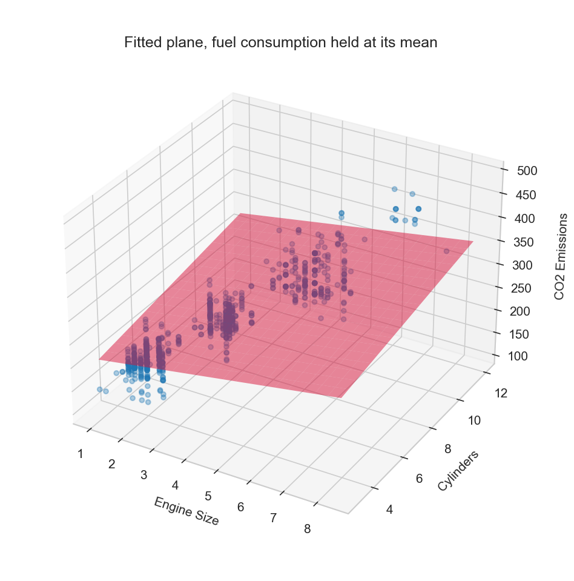

# 02 — Multiple Linear Regression

> Predicting with several input features at once, by fitting a plane instead of a line.

**Notebook:** [`notebook.ipynb`](notebook.ipynb) — the full working, code, and plots.

---

## What this lesson covers

Lesson 01 reached an R² of 0.76 using engine size alone, and the quarter of the
variation it could not explain was everything else about the car. This lesson
hands the model three features instead of one — engine size, cylinder count and
combined fuel consumption — and measures what that buys.

It also covers the part that makes multiple regression harder than it looks:
when the inputs are correlated with each other, the predictions stay reliable
but the individual coefficients stop meaning what they appear to mean.

---

## Intuition

One feature gives a line through a flat scatter plot. Two features give a
**plane** hovering over a 3D cloud of points. Three or more give a *hyperplane*,
which cannot be drawn but behaves exactly the same.

The fitting rule is unchanged: choose the surface that makes the squared vertical
distances to the data as small as possible. All that changes is how many
directions the surface may tilt in — one slope per feature.

---

## The mathematics

**Model**

$$
\hat{y} = b + w_1 x_1 + w_2 x_2 + \cdots + w_n x_n = b + \mathbf{w}^{\top} \mathbf{x}
$$

Simple linear regression is this with $n = 1$, which is why the extension costs
almost nothing in code.

**Cost function** — unchanged, the residual sum of squares over $m$ training
cars:

$$
J(\mathbf{w}, b) = \frac{1}{m} \sum_{i=1}^{m} \left( \hat{y}^{(i)} - y^{(i)} \right)^2
$$

**Finding the parameters — Ordinary Least Squares.** $J$ is quadratic in the
parameters, so setting every partial derivative to zero gives a linear system
with a direct solution. Adding features widens that system but does not change
its nature, which is why fitting stays instant and exact.

---

## The dataset

| Property | Value |
|---|---|
| **Source** | [Fuel consumption ratings, Government of Canada open data](https://open.canada.ca/data/en/dataset/98f1a129-f628-4ce4-b24d-6f16bf24dd64) |
| **Samples** | 1,067 vehicles (model year 2014) |
| **Features used** | `ENGINESIZE`, `CYLINDERS`, `FUELCONSUMPTION_COMB` — and a second run with `FUELCONSUMPTION_CITY` + `_HWY` in place of `_COMB` |
| **Target** | `CO2EMISSIONS` — tailpipe CO2 in grams per kilometre |
| **Split** | 80 / 20, seeded — 859 training rows, 208 test rows |

Each candidate feature correlates strongly with emissions on its own — city
consumption 0.90, combined 0.89, engine size 0.87, cylinders 0.85 — and they
also correlate heavily with **each other**, which is what the results section
has to reckon with.

---

## What the code does

[`notebook.ipynb`](notebook.ipynb) loads the data, keeps the numeric columns,
prints the correlation matrix to expose how related the inputs are, and splits
the rows 80/20 with a seeded generator.

It then fits `LinearRegression` on three features and draws the fitted plane in
3D over engine size and cylinders, with fuel consumption pinned at its mean —
necessarily a slice through a four-dimensional model rather than the whole of it.

Finally it fits a second model on four features, scores both on the held-out test
set, and puts the two side by side.

---

## Results

**Three features** — engine size, cylinders, combined consumption:

$$
\widehat{\text{CO2}} = 63.02 + 10.39 \times \text{engine} + 7.55 \times \text{cylinders} + 9.94 \times \text{consumption}
$$

| Metric | 3 features (COMB) | 4 features (CITY + HWY) |
|---|---|---|
| MAE | 18.47 g/km | 18.50 g/km |
| MSE | 635.97 | 636.55 |
| RMSE | 25.22 g/km | 25.23 g/km |
| R² | 0.8443 | 0.8442 |

Against lesson 01's single feature:

| Model | Features | Test R² | Test MAE |
|---|---|---|---|
| Lesson 01 | 1 | 0.7568 | 24.43 g/km |
| Lesson 02 | 3 | **0.8443** | **18.47 g/km** |

**Reading it.** The extra features carry real information. R² rises from 0.76 to
0.84 and the typical miss drops by about 6 g/km — roughly a quarter of the error
gone. Cars with the same engine size but different fuel consumption can now be
told apart, which is precisely the vertical band the one-feature model had to
average over.

Splitting combined consumption back into its city and highway parts changes
nothing measurable (R² 0.8443 → 0.8442). That is the expected result rather than
a disappointing one: the combined figure is a weighted average of the other two,
so the split adds detail but no new measurement.

**On reading the coefficients.** Each means "grams of CO2 per unit of this
feature, *holding the others fixed*" — and with inputs this correlated, holding
them fixed is close to a fiction. No car in this dataset has a 6-litre engine and
4 cylinders. When features move together the fit divides the shared effect
between them somewhat arbitrarily, so an individual coefficient should not be
read as that feature's physical effect. The predictions are trustworthy; the
attribution is not.

This is the practical limit of the method, and it is what regularisation — Ridge
and Lasso — exists to manage.

---

## References

- Course: Machine Learning with Python (Jadi) — lesson on multiple linear
  regression, which uses this dataset and framing.
- [Fuel consumption ratings — Government of Canada open data](https://open.canada.ca/data/en/dataset/98f1a129-f628-4ce4-b24d-6f16bf24dd64)
- [scikit-learn: Ordinary least squares](https://scikit-learn.org/stable/modules/linear_model.html#ordinary-least-squares)
