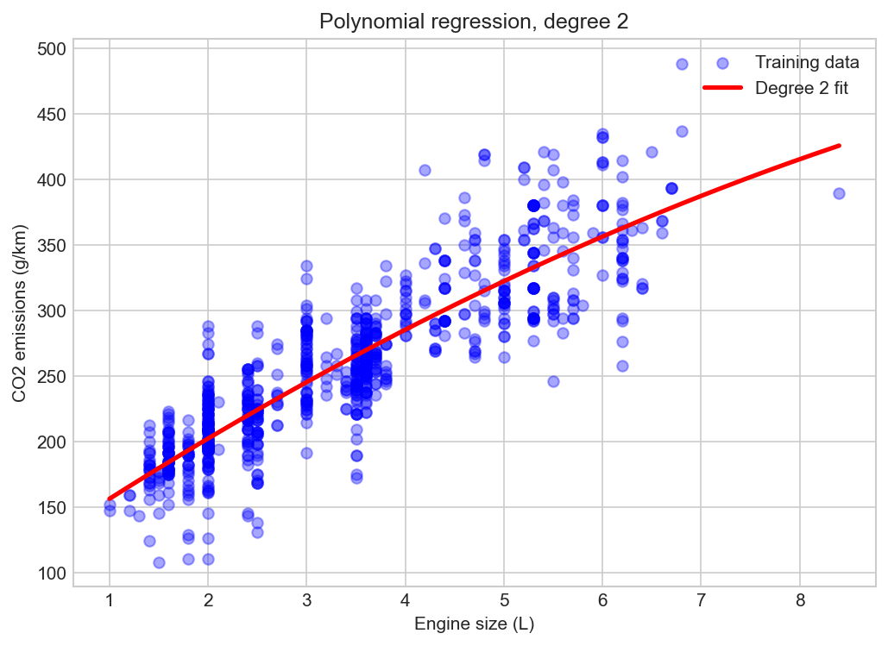

# 03 — Polynomial Regression

> Fitting a curve instead of a straight line, while still using linear regression to do it.

**Notebook:** [`notebook.ipynb`](notebook.ipynb) — the full working, code, and plots.

---

## What this lesson covers

Lessons 01 and 02 could only fit straight lines and flat planes. This lesson
lifts that restriction — without changing the algorithm — by manufacturing new
features from the old ones.

It then asks the question that matters: given permission to bend, does the model
actually fit the data better? The answer here is a clear and useful *no*, and
working out why is the point of the lesson.

---

## Intuition

Instead of changing the model, **change the features**. Give the estimator $x^2$
as an extra column alongside $x$, and a straight-line method produces a curved
prediction — because a straight line through $(x, x^2)$ space is a parabola back
in $x$ space.

This is why polynomial regression is still *linear* regression. "Linear" refers
to the parameters, not to the shape of the graph: the model is a weighted sum of
its features and stays one no matter how those features were built. Squaring a
column is feature engineering, not a new algorithm.

---

## The mathematics

**Model** — a degree-2 polynomial in one variable:

$$
\hat{y} = b + \theta_1 x + \theta_2 x^2
$$

Writing $x_1 = x$ and $x_2 = x^2$ turns this into the multiple linear regression
of lesson 02. The curve comes from how the features were made, not from how they
are combined.

**Building the features** — `PolynomialFeatures(degree=2)` expands each value
into every power up to the chosen degree:

$$
\begin{bmatrix} v_1 \\ v_2 \\ \vdots \\ v_n \end{bmatrix}
\longrightarrow
\begin{bmatrix}
1 & v_1 & v_1^2 \\
1 & v_2 & v_2^2 \\
\vdots & \vdots & \vdots \\
1 & v_n & v_n^2
\end{bmatrix}
$$

The leading column of ones is the degree-0 term and stands in for the intercept.

**Cost function and fitting** — both unchanged: residual sum of squares, solved
in closed form. The estimator neither knows nor cares that one column is the
square of another.

**Degree is a choice, not a result.** It is set by hand, never learned. A higher
degree can always fit the training data at least as well, which is exactly why
training error is useless for choosing it.

---

## The dataset

| Property | Value |
|---|---|
| **Source** | [Fuel consumption ratings, Government of Canada open data](https://open.canada.ca/data/en/dataset/98f1a129-f628-4ce4-b24d-6f16bf24dd64) |
| **Samples** | 1,067 vehicles (model year 2014) |
| **Feature used** | `ENGINESIZE` — engine displacement in litres |
| **Target** | `CO2EMISSIONS` — tailpipe CO2 in grams per kilometre |
| **Split** | 80 / 20, seeded — 859 training rows, 208 test rows |
| **Preprocessing** | `PolynomialFeatures` expansion to degrees 1 through 4 |

The same single feature as lesson 01, deliberately: the question is whether
curvature helps, so nothing else may change.

---

## What the code does

[`notebook.ipynb`](notebook.ipynb) expands engine size to degree 2, fits
`LinearRegression` on the expanded columns, and plots the resulting curve over
the training data.

It then loops over degrees 1 to 4, fitting each on the **same** split and
recording both training and test scores, so the comparison isolates the effect of
degree and nothing else.

One detail worth noting: the expansion is fitted with `fit_transform` on the
training data but applied with `transform` on the test data. For
`PolynomialFeatures` this changes nothing numerically, but the habit matters —
any transformer that learns something from data (a scaler learning a mean, an
encoder learning categories) must learn it from the training set alone, or test
information leaks into the pipeline and the reported score stops being honest.

---

## Results

The degree-2 fit:

$$
\widehat{\text{CO2}} = 107.17 + 50.50 \, x - 1.50 \, x^2
$$

Every degree, fitted and scored on the same split:

| Degree | Train R² | Test R² | Test MAE | Test MSE |
|---|---|---|---|---|
| 1 (straight line) | 0.7657 | 0.7568 | 24.43 g/km | 993.50 |
| 2 (quadratic) | 0.7681 | 0.7597 | 24.48 g/km | 981.71 |
| 3 (cubic) | 0.7687 | 0.7621 | 24.26 g/km | 971.71 |
| 4 (quartic) | 0.7688 | 0.7623 | 24.22 g/km | 971.14 |

**Reading it.** Moving from a straight line to a quadratic changes test R² by
0.003. A cubic adds 0.002 more. Against a typical error of roughly 24 g/km, none
of this is a meaningful improvement — and the curves plotted together are almost
indistinguishable.

**The honest conclusion is that this relationship is essentially straight.**
Polynomial features gave the model permission to bend and it barely used it. That
is a real result, not a failed experiment: the method was applied correctly and
the data said no.

Two things worth noticing in the table:

- **Train R² never decreases as degree rises** (0.7657 → 0.7688). It cannot: a
  higher-degree model contains every lower-degree one as a special case, so it
  can always match it by zeroing the extra coefficients. This is exactly why
  degree must never be chosen on training scores.
- **Test R² is what tells the truth**, and it flattens almost immediately. Pushed
  far enough, a high-degree polynomial starts chasing individual points and test
  R² falls while train R² keeps climbing — the textbook picture of overfitting.

Set against lesson 02, the comparison is instructive. Adding *real* features
moved R² from 0.76 to 0.84. Bending the line through a single feature moves it
from 0.757 to 0.762. The vertical spread at each engine size is caused by
properties of the car this model cannot see, and no amount of curvature can
invent information that is not there.

---

## References

- Course: Machine Learning with Python (Jadi) — lesson on polynomial regression,
  which uses this dataset and framing.
- [Fuel consumption ratings — Government of Canada open data](https://open.canada.ca/data/en/dataset/98f1a129-f628-4ce4-b24d-6f16bf24dd64)
- [scikit-learn: Polynomial regression](https://scikit-learn.org/stable/modules/linear_model.html#polynomial-regression-extending-linear-models-with-basis-functions)
