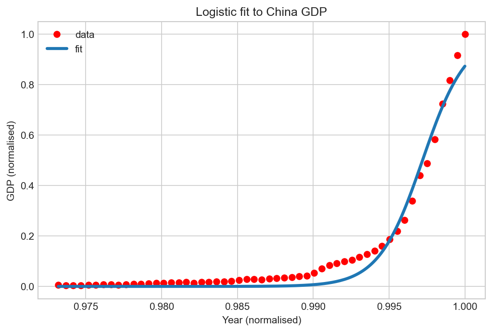

# 04 — Non-Linear Regression

> Fitting a model whose shape is chosen in advance, when no straight line and no polynomial will do.

**Notebook:** [`notebook.ipynb`](notebook.ipynb) — the full working, code, and plots.

---

## What this lesson covers

China's GDP from 1960 to 2014 creeps along for decades, accelerates sharply from
the early 2000s, and begins to flatten in the 2010s. No straight line describes
that, and lesson 03 showed that bending a line through polynomial features has
its own hard limit: every polynomial eventually runs off to infinity, so none of
them can express something that levels out.

This lesson takes the other route — **choose the function**, then fit its
parameters. It covers the common non-linear shapes, why a logistic curve suits
this data, and how `curve_fit` finds parameters when no closed-form solution
exists.

---

## Intuition

Lesson 03 kept the algorithm and manufactured features. Non-linear regression
inverts that: decide in advance that the relationship is exponential, or
logarithmic, or S-shaped, and let an optimiser position that shape on the data.

The trade is clear. Choosing well means very few parameters and a model that
extrapolates sensibly, because the shape itself encodes knowledge about how the
process behaves. Choosing badly means no amount of fitting will rescue it.

---

## The mathematics

**What makes a model non-linear.** "Linear" refers to the *parameters*, not the
graph. Lesson 03's $\hat{y} = b + \theta_1 x + \theta_2 x^2$ curves on a chart
but is still a weighted sum of features, so it is linear in the relevant sense.

A model is non-linear when a parameter sits inside a function — an exponent, a
logarithm, a denominator:

$$
\hat{y} = \frac{1}{1 + e^{-\beta_1 (x - \beta_2)}}
$$

No rearrangement turns this into a weighted sum, so the closed-form least squares
solution used in lessons 01–03 does not exist.

**Fitting it.** The cost is still the residual sum of squares:

$$
J(\beta) = \sum_{i=1}^{m} \left( \hat{y}^{(i)} - y^{(i)} \right)^2
$$

but with no formula for its minimum, the parameters have to be searched for.
`scipy.optimize.curve_fit` starts from an initial guess and steps downhill until
the residuals stop improving. Two consequences follow: the result depends on
where the search starts, and the variables need to be on a sensible scale or the
optimiser struggles.

**The logistic function** — the shape chosen here:

$$
\hat{Y} = \frac{1}{1 + e^{\beta_1 (X - \beta_2)}}
$$

$\beta_1$ controls steepness; $\beta_2$ slides the curve along the x-axis.

---

## The dataset

| Property | Value |
|---|---|
| **Source** | China GDP 1960–2014, World Bank world development indicators |
| **Samples** | 55 annual observations |
| **Feature used** | `Year` |
| **Target** | `Value` — GDP in current US dollars |
| **Split** | None — see *On evaluation* below |
| **Preprocessing** | Both axes divided by their maximum, giving a 0–1 range |

Normalising matters more than usual here. Years run in the thousands and GDP in
the trillions; an optimiser searching over raw values like those takes steps that
are wildly wrong for one axis or the other. It also matches the standard
logistic, which saturates at 1.

---

## What the code does

[`notebook.ipynb`](notebook.ipynb) first walks through the common non-linear
shapes — linear, cubic, quadratic, exponential, logarithmic and sigmoidal — so
the choice of model is a decision rather than a guess.

It then plots the GDP series, identifies the S-shape, defines the sigmoid, and
checks by hand that a sigmoid can plausibly sit on the data before fitting
anything. After normalising both axes, `curve_fit` searches for the parameters
that minimise the squared residuals.

---

## Results

Fitted parameters on the normalised data:

| Parameter | Value | Meaning |
|---|---|---|
| $\beta_1$ | 690.45 | Steepness of the transition |
| $\beta_2$ | 0.9972 | Where the curve turns, on the normalised year axis |

**Reading it.** Two parameters reproduce the broad shape of fifty-five years of
growth: flat for decades, then a sharp turn upward. The large $\beta_1$ says that
transition is abrupt — on the normalised axis the curve turns over a very narrow
span, matching the takeoff after 2000.

But the fit is visibly imperfect, and the reason is worth understanding rather
than glossing over. Through the 1990s and early 2000s the curve sits *below* the
observed points, and at the right-hand end it undershoots the most recent years:
the final observation reaches 1.0 while the curve stops well short of it.

The cause is the model, not the optimiser. This sigmoid has exactly two
parameters — steepness and position — and none for its ceiling: it saturates at
exactly 1.0 by construction. Since the data were normalised by their own maximum,
the last observation *is* 1.0, so the curve is being asked to reach its asymptote
at the very last data point, which a logistic only does in the limit. Least
squares settles the conflict by compromising, sitting low at the end to avoid
larger errors through the middle.

Fitting $a / (1 + e^{-\beta_1 (x - \beta_2)})$ with a third parameter for the
ceiling would lift that constraint. The two-parameter form is what the lesson
teaches, and its limitation is visible in the plot.

**What this does not justify.** The logistic shape asserts that growth approaches
a ceiling — an assumption taken from the look of the curve, not from economics.
The data stop in 2014, barely past the point where flattening begins.
Extrapolating to find *where* that ceiling sits would read far more into two
parameters than 55 points can support. The fit describes the period it was given;
it is not a forecast.

**On evaluation.** Unlike lessons 01–03, this model is fitted on every available
point and carries no held-out score. That is deliberate. With 55 annual
observations, a random train/test split is the wrong instrument: holding out
scattered years asks the model only to interpolate between neighbours it has
already seen, which is easy and flatters the result. The meaningful test for a
time series is temporal — fit on the earlier years, predict the later ones. This
lesson stops short of that, and doing it is the obvious next step.

---

## References

- Course: Machine Learning with Python (Jadi) — lesson on non-linear regression,
  which uses this dataset and framing.
- Dataset: China GDP 1960–2014, World Bank world development indicators.
- [SciPy: `scipy.optimize.curve_fit`](https://docs.scipy.org/doc/scipy/reference/generated/scipy.optimize.curve_fit.html)
