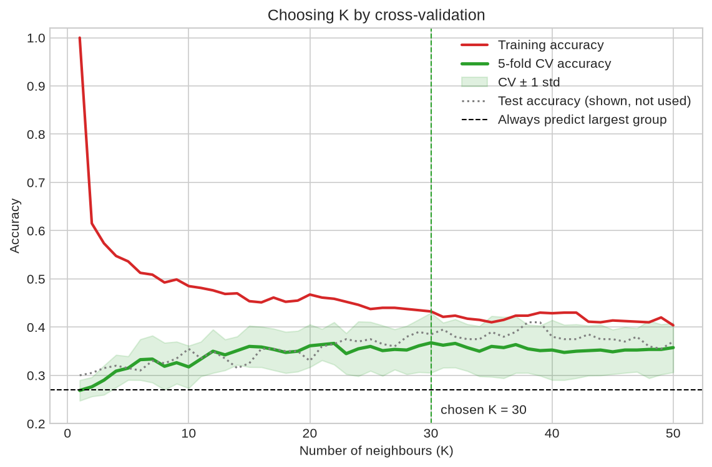

# 05 — k-Nearest Neighbours

> Classifying a new case by letting the most similar known cases vote.

**Notebook:** [`notebook.ipynb`](notebook.ipynb) — the full working, code, and plots.

---

## What this lesson covers

The first classification lesson. Lessons 01–04 predicted a number; this one
predicts which of four customer groups a telecom customer belongs to, from
eleven demographic columns.

It covers how KNN classifies, why its features must be scaled, and how to choose
K without spending the test set. It also covers what accuracy means once there
is a baseline to compare it against.

---

## Intuition

Similar customers tend to buy similar plans. To classify a new customer, find
the K existing customers most like them and let those K vote. The group that
appears most often wins.

"Most like them" means closest, once every customer is a point in space with one
axis per feature. So the answer depends on how distance is measured, and on K
itself: the same point can be classed one way with K = 3 and the other way with
K = 6.

---

## The mathematics

**Distance** — Euclidean, over the $n$ features:

$$
d(\mathbf{x}, \mathbf{x}') = \sqrt{\sum_{j=1}^{n} \left( x_j - x'_j \right)^2}
$$

**Prediction** — a majority vote among the $K$ nearest training points
$N_K(\mathbf{x})$:

$$
\hat{y} = \underset{c}{\arg\max} \sum_{i \in N_K(\mathbf{x})} \mathbb{1}\left( y^{(i)} = c \right)
$$

**There is no cost function and nothing is fitted.** `fit()` only stores the
training set, and all the work happens at prediction time, when a new point is
compared against every stored point. This is the break from lessons 01–04, and
it is why KNN is called a *lazy* learner.

**Scaling is not optional.** Distance adds up squared differences, so a feature
in large units dominates it: income in hundreds would drown out marital status
in 0/1. Each feature is standardised to $z_j = (x_j - \mu_j) / \sigma_j$, with
$\mu_j$ and $\sigma_j$ taken from the **training** set only.

**K is a hyperparameter.** With $K = 1$ every training point is its own nearest
neighbour, so training accuracy is a meaningless 100%. A very large K just
predicts the most common class. The right K lies between the two and has to be
measured.

---

## The dataset

| Property | Value |
|---|---|
| **Source** | Telecommunications customer records (`teleCust1000t.csv`), as supplied with the course |
| **Samples** | 1,000 customers, no missing values |
| **Features used** | `region`, `tenure`, `age`, `marital`, `address`, `income`, `ed`, `employ`, `retire`, `gender`, `reside` |
| **Target** | `custcat`: 1 Basic, 2 E-Service, 3 Plus, 4 Total Service |
| **Split** | 80 / 20, `random_state=4`: 800 training rows, 200 test rows |
| **Preprocessing** | `StandardScaler`, fitted on training data only |

The four groups are close to balanced (266 / 217 / 281 / 236). That sets a
floor: always guessing the largest group, Plus Service, scores **0.27** on the
test set.

---

## What the code does

[`notebook.ipynb`](notebook.ipynb) opens with a small hand-made example showing
the same point flip class between K = 3 and K = 6.

It then loads the data, checks class balance and feature scales, and splits the
rows. The scaler is fitted on the training rows only. Fitting it before the
split, the common shortcut, would let test customers shape the scaling.

It fits K = 4 and K = 6, compares training and test accuracy, and measures a
"most frequent class" baseline so the scores have something to be judged
against.

K is then chosen from 1 to 50 by **5-fold cross-validation on the training
set**, with the scaler inside a `Pipeline` so each fold scales on its own
training part. Test accuracy is recorded alongside for comparison but plays no
part in the choice. The chosen model is scored on the test set once, with a
confusion matrix and per-class precision and recall.

---

## Results

| Model | K | Test accuracy |
|---|---|---|
| Always predict the largest group | — | 0.270 |
| KNN, first attempt | 4 | 0.320 |
| KNN, first attempt | 6 | 0.310 |
| **KNN, K chosen by cross-validation** | **30** | **0.385** |
| *KNN, K chosen by peeking at the test set* | *38* | *0.410, not a valid result* |

**Reading it.** The chosen model places about two customers in five in the right
group. Guessing the most common group manages about one in four. The features
carry real signal, but not much.

The curves tell the familiar story from lesson 03. Training accuracy starts at
1.0 for K = 1, which is pure memorisation, and falls as K grows.
Cross-validated accuracy rises from 0.27 and plateaus around 0.35–0.37 from
K ≈ 15. On that plateau the fold-to-fold spread (±0.05) is wider than the
differences between neighbouring K values, so K = 30 is simply the highest point
of a flat stretch. Anything from about 15 to 50 is equally defensible.

**Why the test set was not used to choose K.** Picking the K with the best test
score would have reported 0.41, the best of fifty attempts on the same 200
customers. The typical noise in an accuracy measured on 200 rows is about ±3.4
points, so that 2.5-point "gain" is selection luck, not a better model. The
honest number is 0.385.

**Where it fails.** The confusion matrix shows the model predicting *Basic* for
76 of the 200 test customers, when only 51 are Basic.

- *Plus* customers are sent to Basic almost as often as to Plus (22 against 21).
- *Total Service* is the worst-served group: only 14 of 51 are recognised.
- When the model says *E-Service*, it is right about half the time, the best of
  the four.

**Why the ceiling is low.**

- Demographics say little about how someone uses a phone service. No value of K
  gets cross-validated accuracy much past 0.37.
- KNN gives every feature an equal say in the distance. `gender` counts as much
  as `tenure`, and the method cannot learn otherwise, so features with no signal
  add noise to every comparison. Models that learn a weight per feature, such as
  logistic regression and decision trees, can discount them.
- `region` is a label entered as the numbers 1, 2, 3, which makes region 1
  "further" from 3 than from 2 for no reason. One-hot encoding it, as the Tehran
  project did for neighbourhoods, would remove that.

---

## References

- Course: Machine Learning with Python (Jadi), lesson on k-nearest neighbours,
  which uses this dataset and framing.
- Dataset: `teleCust1000t.csv`, telecommunications customer records, as
  supplied with the course.
- [scikit-learn: Nearest neighbors classification](https://scikit-learn.org/stable/modules/neighbors.html#classification)
- [scikit-learn: Cross-validation](https://scikit-learn.org/stable/modules/cross_validation.html)
