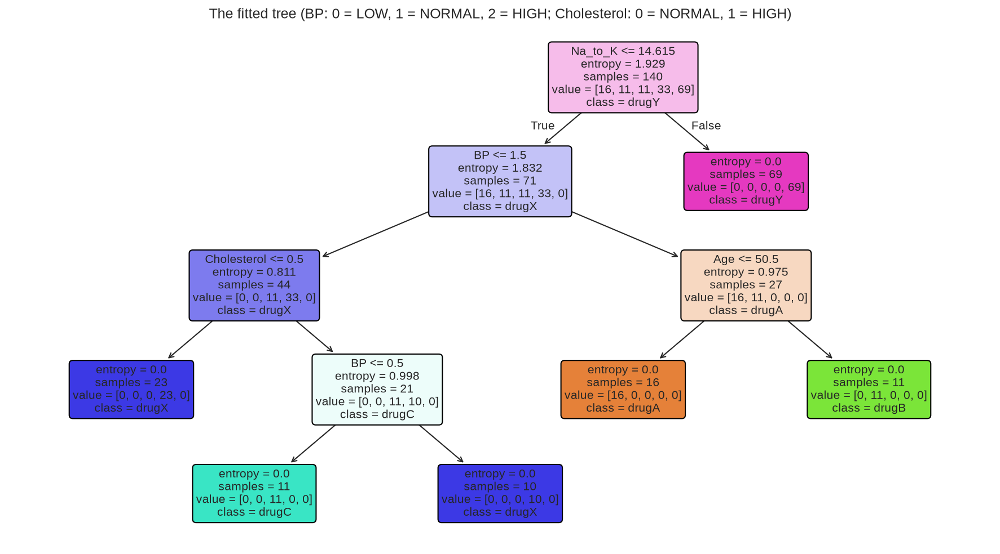

# 06 — Decision Trees

> Classifying by asking a short sequence of yes/no questions, each chosen to leave the groups as pure as possible.

**Notebook:** [`notebook.ipynb`](notebook.ipynb) — the full working, code, and plots.

---

## What this lesson covers

The second classification lesson. The task is to predict which of five drugs a
patient responded to, from age, sex, blood pressure, cholesterol and blood
sodium-to-potassium ratio. The model has to be one that a person can read.

It covers entropy and information gain, which the tree uses to choose each
question. It also covers encoding categories in an order the tree can use,
choosing `max_depth` by cross-validation, and why a near-perfect score here says
more about the data than about the method.

---

## Intuition

A decision tree is a flowchart learned from data. It asks one question about one
feature, such as *is Na_to_K above 14.6?*, and sends each patient left or right.
Each side asks its own next question, until every group is a single drug.

The whole method comes down to choosing questions. At every step the tree tries
every feature and threshold, and keeps the question whose two resulting groups
are the purest.

---

## The mathematics

**Entropy**: how mixed a group is, where $p_c$ is the share of drug $c$:

$$
H = -\sum_{c} p_c \log_2 p_c
$$

A group that is all one drug has $H = 0$. An even two-way split has
$H = 1$ bit. Five drugs in equal shares has $\log_2 5 \approx 2.32$ bits.

**Information gain**: how much a question reduces entropy. A split sends $n_L$
of the $n$ patients left and $n_R$ right:

$$
\text{IG} = H(\text{parent}) - \left( \frac{n_L}{n} H(\text{left}) + \frac{n_R}{n} H(\text{right}) \right)
$$

**Greedy growth.** At each node the tree keeps the feature and threshold with
the highest gain, then repeats on each child. It stops when a node is pure or
`max_depth` is reached. Choices are never revisited.

**No distances, so no scaling.** A threshold on one feature is unaffected by the
units of another, so unlike KNN in lesson 05, nothing needs standardising. The
features do need to be numbers, and ordered categories should be coded in their
real order.

---

## The dataset

| Property | Value |
|---|---|
| **Source** | Patient drug-response records (`drug200.csv`), as supplied with the course |
| **Samples** | 200 patients, no missing values, no duplicates |
| **Features used** | `Age`, `Sex`, `BP`, `Cholesterol`, `Na_to_K` |
| **Target** | `Drug`: drugA, drugB, drugC, drugX, drugY |
| **Split** | 70 / 30, `random_state=3`: 140 training rows, 60 test rows |
| **Preprocessing** | `BP` coded LOW 0 / NORMAL 1 / HIGH 2; `Sex` and `Cholesterol` coded 0 / 1 |

The classes are unbalanced: drug Y alone is 91 of the 200 patients. Always
answering drug Y scores **0.367** on this test set.

**On encoding.** The common shortcut, `LabelEncoder`, codes categories
alphabetically. That gives blood pressure HIGH 0, LOW 1, NORMAL 2, which puts
normal pressure above high. A tree can only ask "is BP at most some value?", so
with that coding it cannot ask "is BP high?" in one question. BP is therefore
mapped by hand in its real order.

---

## What the code does

[`notebook.ipynb`](notebook.ipynb) defines entropy as a small function and checks
it on toy groups. It then plots `Na_to_K` against age. That plot already shows
one line separating drug Y from every other drug.

After encoding and splitting, it fits
`DecisionTreeClassifier(criterion="entropy", max_depth=4)`. It then checks the
tree's first question **by hand**: it computes the root's information gain from
the formulas, confirms it matches scikit-learn's, and ranks every feature's best
possible first split.

The tree is drawn with scikit-learn's own `plot_tree`, which needs no Graphviz
install, and also printed as text. Finally the notebook:

- scores the tree against the baseline;
- compares depths 1–5 and unlimited by 5-fold cross-validation on the training
  set;
- examines the one test patient the tree gets wrong.

---

## Results

Read from the top, the tree is a complete prescribing rule:

1. **Na_to_K above ~14.6** → drug Y
2. Otherwise **high BP** → drug A if aged 50 or under, drug B if older
3. Otherwise **low BP and high cholesterol** → drug C
4. Everyone else → drug X

`Sex` never appears. Its best possible first split has the lowest information
gain of any feature, 0.014 bits, against 1.000 for `Na_to_K`.

| max_depth | Actual depth | Train | 5-fold CV | Test (not used to choose) |
|---|---|---|---|---|
| 1 | 1 | 0.729 | 0.729 | 0.700 |
| 2 | 2 | 0.843 | 0.843 | 0.817 |
| 3 | 3 | 0.929 | 0.907 | 0.817 |
| **4** | **4** | **1.000** | **0.993** | **0.983** |
| unlimited | 4 | 1.000 | 0.993 | 0.983 |

| Model | Test accuracy |
|---|---|
| Always predict drug Y | 0.367 |
| **Decision tree, max_depth = 4** | **0.983** (59 of 60) |

**Reading it.** `max_depth=4` never constrained this tree. With no limit, it
still stops at depth 4, because by then every leaf holds a single drug.

**The one error.** The misclassified patient has Na_to_K **14.642** and took
drug X. In the full dataset, that is the highest ratio of any non-Y patient. The
lowest ratio of any drug-Y patient is 15.015, so the real boundary lies
somewhere in between. This patient was in the test set, so the tree never saw
them. It placed its threshold halfway between the nearest training values, at
14.615, and the patient landed about 0.03 on the wrong side. Every tree
threshold is a midpoint between observed values; the model cannot know where in
an empty gap the true boundary sits.

**What 98% does and does not mean.** The four rules above reproduce all 200
drug labels exactly. That makes the tree a complete description of this dataset,
which was evidently generated from rules like these for teaching. The score
shows the tree **recovered the rules that generated the data**. It does not show
that drug response is easy to predict, and none of this is a basis for
prescribing anything.

**The weakness to carry forward.** Grown until its leaves are pure, a tree fits
its training data perfectly. On noisy data, that means memorising the noise.
Here there was no noise, so the unlimited tree did no harm. On real data, depth
has to be limited, and a single tree can change a lot when a few training rows
change. Ensembles of trees, such as random forests, exist to fix that.

---

## References

- Course: Machine Learning with Python (Jadi), lesson on decision trees, which
  uses this dataset and framing.
- Dataset: `drug200.csv`, patient drug-response records, as supplied with the
  course.
- [scikit-learn: Decision Trees](https://scikit-learn.org/stable/modules/tree.html)
- [scikit-learn: `plot_tree`](https://scikit-learn.org/stable/modules/generated/sklearn.tree.plot_tree.html)
