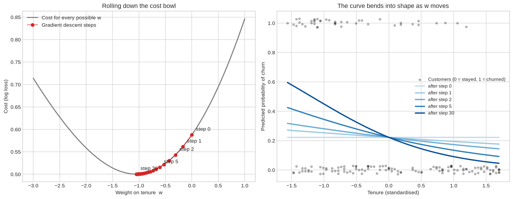
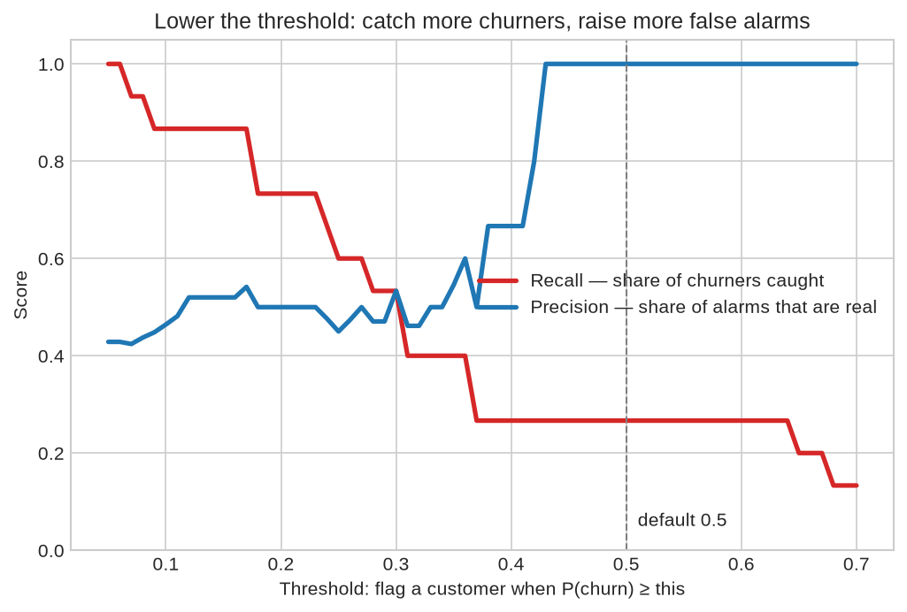

# 07 — Logistic Regression

> Predicting the *probability* of a yes/no outcome — and the first model in this repository that learns by gradient descent.

**Notebook:** [`notebook.ipynb`](notebook.ipynb) — the full working, code, and plots.

---

## What this lesson covers

A telecom company wants to know which customers are about to leave, while there
is still time to keep them. Logistic regression predicts a **probability** of
leaving ("churn") for each customer, from seven account and demographic
features.

The lesson covers:

- the sigmoid, which turns a score into a probability;
- log loss, the cost that judges probabilities;
- **gradient descent**, the search that finds the weights. It is built by hand
  in ten lines of NumPy and checked against scikit-learn.

It also covers the tools for judging a yes/no classifier: the confusion matrix,
precision and recall, and choosing a threshold.

The notebook is written to be learned from. The maths comes in small steps, each
paired with the line of code that does it, and cells marked **Try it yourself**
have a setting to change and re-run.

---

## Intuition: linear score, then squash

Linear regression computes a weighted sum of the features, a *score*. A score
can be any number, but a probability must stay between 0 and 1. Logistic
regression adds one step: it passes the score through the **sigmoid**, an S-curve
that maps any number into (0, 1).

That is the whole model. Everything else is about finding good weights.

---

## The mathematics, in five small steps

| Step | Formula | In plain words | In code |
|---|---|---|---|
| 1. Score | $z = b + \mathbf{w} \cdot \mathbf{x}$ | Weighted sum of the features, as in linear regression | `z = X @ w + b` |
| 2. Squash | $p = \sigma(z) = \frac{1}{1 + e^{-z}}$ | Turn the score into a probability | `p = sigmoid(z)` |
| 3. Meaning | $\log \frac{p}{1-p} = z$ | The score is the log of the odds; $e^{w_j}$ multiplies the odds per unit of $x_j$ | `np.exp(w)` |
| 4. Cost | $J = -\frac{1}{m}\sum \big[ y \log p + (1-y) \log(1-p) \big]$ | Penalty is $-\log$ of the probability given to what really happened | `-np.mean(y*np.log(p) + (1-y)*np.log(1-p))` |
| 5. Learn | $w_j \leftarrow w_j - \alpha \cdot \frac{1}{m}\sum (p - y)\,x_j$ | Nudge each weight downhill by *error × input* | `w -= alpha * X.T @ (p - y) / m` |

**Step 4, the cost.** Being right with confidence costs almost nothing:
$-\log 0.99 = 0.01$. A coin-flip costs 0.69. Being confidently wrong costs the
most: $-\log 0.01 = 4.6$.

**Step 5, gradient descent.** Picture yourself in fog on a hillside, trying to
reach the bottom of the valley. You can't see the bottom, but you can feel which
way the ground slopes. So you take a step downhill, feel again, and repeat until
the ground is flat.

- The hillside is the cost.
- Your position is the current set of weights.
- The slope under your feet is the gradient.
- The learning rate $\alpha$ is the length of each step.

Unlike lessons 01–03, there is no formula that jumps straight to the bottom. The
sigmoid makes the equations unsolvable directly, so the weights have to be
*searched for*.

The slope has a simple form: **error × input**, averaged over customers. If the
model under-predicts churn for customers with a high value of some feature, that
feature's weight goes up. Every customer nudges every weight in the direction
that would have made their own prediction less wrong.

---

## The dataset

| Property | Value |
|---|---|
| **Source** | Telecom customer churn records (`ChurnData.csv`), as supplied with the course |
| **Samples** | 200 customers, 28 columns, no missing values |
| **Features used** | `tenure`, `age`, `address`, `income`, `ed`, `employ`, `equip` |
| **Target** | `churn`: 1 = left within the last month (58 of 200) |
| **Split** | 80 / 20, `random_state=4`: 160 training rows, 40 test rows |
| **Preprocessing** | `StandardScaler`, fitted on training data only |

Scaling matters twice here. It makes every weight comparable, "per one standard
deviation". It also makes gradient descent work: without it the cost bowl is a
long, narrow canyon, and no single step size suits every direction.

---

## What the code does

[`notebook.ipynb`](notebook.ipynb):

1. **One step of gradient descent by hand**, on four toy customers. After a
   single step the model has already learned that longer tenure means less
   churn.
2. **The full algorithm from scratch** in ten lines, with its cost falling from
   0.693 to 0.438.
3. **Watching it learn.** On one feature, each step is shown as a ball rolling
   down the cost bowl, alongside the prediction curve bending into shape. This is
   the figure below.
4. **Try it yourself: the learning rate.** 0.01 crawls, 1.0 converges in a few
   dozen steps, and 20 overshoots so badly the cost ends *higher* than it
   started.
5. **Checked against scikit-learn.** The hand-written version finds the same
   weights to three decimal places.
6. **scikit-learn's `C`**, a penalty on large weights. A small `C` means a strong
   pull toward zero, and the course's `C=0.01` squeezes every probability into a
   narrow band. `C` is chosen by 5-fold cross-validation on log loss, using the
   training set only.
7. **Evaluation:**
   - baselines;
   - confusion matrix, precision, recall, F1 and Jaccard;
   - how moving the threshold trades churners caught against false alarms;
   - the weights read as odds multipliers.

---

## Results

Cross-validation chose **C = 0.3**. Values from 0.1 to 1 were all within noise
of each other.

| Model | Test accuracy | Test log loss |
|---|---|---|
| Always predict "stays" / give everyone the churn rate | 0.625 | 0.688 |
| **Logistic regression, C = 0.3** | **0.725** | **0.611** |

**Moving the threshold:**

| Flag a customer when P(churn) ≥ | Churners caught (of 15) | False alarms | Precision | Recall | Accuracy |
|---|---|---|---|---|---|
| 0.5 (default) | 4 | 0 | 1.00 | 0.27 | 0.725 |
| 0.3 | 8 | 7 | 0.53 | 0.53 | 0.650 |
| 0.2 | 11 | 11 | 0.50 | 0.73 | 0.625 |

**Reading it.** The model beats both baselines, by a modest margin. The features
carry real information about who leaves, but not a lot. On 40 test customers, one
customer is 2.5 points of accuracy and the noise is about ±7 points. The course's
`C=0.01` version scored 0.75, one customer more, and that difference is noise.

**The threshold matters more than accuracy.** At 0.5 the model is cautious: every
customer it flags really churns, but it catches only 4 of 15. For a retention
team that is the wrong trade, because a missed churner is a lost customer while
a false alarm costs one unneeded offer.

At 0.2 the model catches 11 of 15, and accuracy *falls* to 0.625 even though the
model has become far more useful. The right threshold depends on what each kind
of mistake costs. Only a model that outputs probabilities lets you choose it.

**The weights, as odds multipliers:**

- **Tenure** matters most: about 22 more months as a customer roughly halves the
  odds of churning (×0.48).
- **Renting equipment** multiplies the odds by about 3.9.
- Longer employment, older age and more years at the same address lower the odds
  a little. **Income** barely matters.

Each multiplier assumes the other features are held fixed. Tenure, age,
employment and address rise together, so the split of credit between them is
not precise. These are also associations, not causes.

---

## References

- Course: Machine Learning with Python (Jadi), lesson on logistic regression,
  which uses this dataset and framing.
- Dataset: `ChurnData.csv`, telecom customer churn records, as supplied with the
  course.
- [scikit-learn: Logistic regression](https://scikit-learn.org/stable/modules/linear_model.html#logistic-regression)
- [scikit-learn: Classification metrics](https://scikit-learn.org/stable/modules/model_evaluation.html#classification-metrics)
