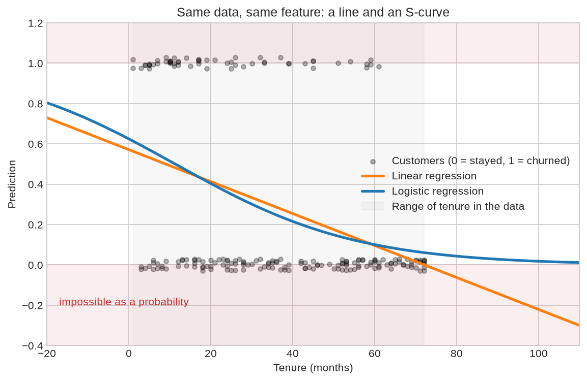
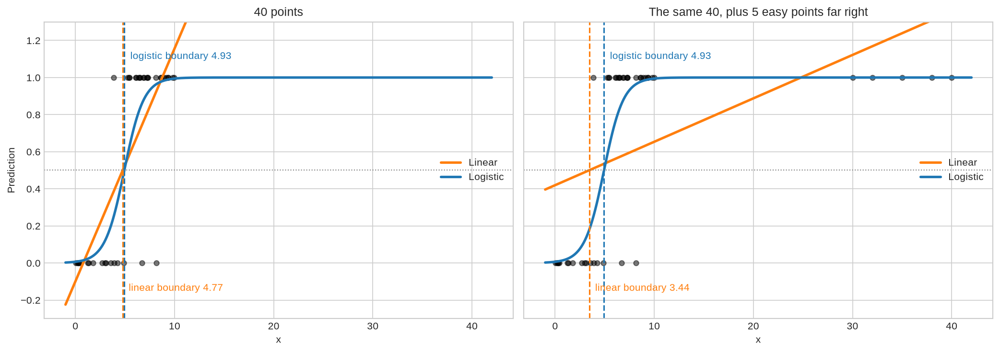

# 08 — Linear vs Logistic Regression

> Same weighted sum, different question: how the two models are alike, where they part ways, and how to choose.

**Notebook:** [`notebook.ipynb`](notebook.ipynb) — the full working, code, and plots.

---

## What this lesson covers

Lessons 01–04 used linear regression and lesson 07 introduced logistic
regression. They share a name, a formula and even a training loop, which makes
them easy to mix up. This lesson compares them side by side on the same churn
data and checks every claim with code.

**Linear regression answers "how much?" Logistic regression answers "how
likely?"** Despite its name, logistic regression is a *classification* model.

---

## At a glance

| | Linear regression | Logistic regression |
|---|---|---|
| **Question** | How much? | How likely? |
| **Target** | A number (price, emissions) | A category, usually 0 / 1 |
| **Output** | Any number | A probability, 0 to 1 |
| **Model** | $\hat{y} = b + \mathbf{w} \cdot \mathbf{x}$ | $p = \sigma(b + \mathbf{w} \cdot \mathbf{x})$ |
| **Shape** | Straight line | S-curve |
| **Cost** | Mean squared error | Log loss |
| **Fitting** | Exact formula *or* gradient descent | Gradient descent (no formula exists) |
| **A weight means** | Units of $y$ per unit of $x$ | Odds multiplied by $e^{w}$ per unit of $x$ |
| **Judged by** | MAE, RMSE, R² | Accuracy, precision, recall, log loss |

---

## Intuition

Both models start by computing a **weighted sum of the features**, a score.

- Linear regression **uses the score as the answer**, which draws a straight
  line.
- Logistic regression **squashes the score** through the sigmoid so it lands
  between 0 and 1, which draws an S-curve.

When the target is a number, a line is natural. When the target is 0 or 1, the
data sit on two horizontal rows, and a straight line through two rows has
nowhere sensible to go.

---

## The mathematics, side by side

| | Linear | Logistic |
|---|---|---|
| Score | $z = b + \mathbf{w} \cdot \mathbf{x}$ | $z = b + \mathbf{w} \cdot \mathbf{x}$ |
| Prediction | $\hat{y} = z$ | $p = \sigma(z)$ |
| Cost | $\frac{1}{2m}\sum (\hat{y} - y)^2$ | $-\frac{1}{m}\sum \big[y \log p + (1-y)\log(1-p)\big]$ |
| Slope for $w_j$ | $\frac{1}{m}\sum (\hat{y} - y)\,x_j$ | $\frac{1}{m}\sum (p - y)\,x_j$ |

Look at the last row. **The slope has the same form for both, error × input**,
so one gradient descent loop trains both models if you change the line that
makes the prediction.

The real difference is the cost:

- Squared error asks *how far off was the number?*
- Log loss asks *how much probability did you give to what really happened?*

---

## The dataset

| Property | Value |
|---|---|
| **Source** | Telecom customer churn records (`ChurnData.csv`), as supplied with the course |
| **Samples** | 200 customers; `churn` = 1 for 58 of them |
| **Features used** | `tenure`, `age`, `address`, `income`, `ed`, `employ`, `equip` |
| **Split** | 80 / 20, `random_state=4`: 160 training rows, 40 test rows |
| **Preprocessing** | `StandardScaler`, fitted on training data only |

It is a yes/no problem, logistic regression's home ground. That makes it the
right place to see what linear regression does when it's asked the wrong kind of
question. Experiment 3 also uses a small made-up dataset where the right answer
is known.

---

## What the code does, and what it found

[`notebook.ipynb`](notebook.ipynb) runs six experiments.

**1. Both models on one feature (tenure).**

Inside the data the two are close. At the edges the line keeps going. A customer
with 100 months of tenure gets a churn "probability" of **−0.22** from linear
regression and **0.018** from logistic regression.

**2. All seven features.** Linear regression predicts below zero for **29 of the
200 customers**. At a 0.5 cut-off, though, both models reach the same test
accuracy, **0.725**.

As probabilities, logistic regression is better: log loss **0.636** against
**0.667**. And linear regression's outputs had to be forced into 0.01–0.99
before they could be scored at all.

So a line used as a yes/no classifier doesn't always fail loudly. Its
probabilities are what break.

**3. More obvious data makes the line worse.**

Forty made-up points with a boundary near 5. Then five more points are added far
to the right, all correctly labelled and as easy as points get.

| | Linear boundary | Logistic boundary | Linear accuracy | Logistic accuracy |
|---|---|---|---|---|
| 40 points | 4.77 | 4.93 | 0.90 | 0.925 |
| + 5 easy points | **3.44** | **4.93** | **0.85** | 0.925 |

Squared error cares about *distance*, so the far points tilt the line and move
its boundary. Log loss already gives them a probability of almost exactly 1, so
they cost nothing and pull nothing.

**4. The two costs for one customer.** For a customer who churned, a prediction
of 1% costs **0.98** under squared error, barely more than 10% (0.81). Log loss
charges **4.6**. Squared error can never charge more than 1, however confident
the mistake, which makes it the wrong ruler for probabilities.

**5. One training loop for both.** A single gradient descent function with a
`squash` switch (`no_squash` or `sigmoid`) reproduces both of scikit-learn's
models to three decimal places. That one line is the whole difference between
predicting a number and predicting a probability.

**6. Reading a weight.** In linear regression, 12 more months of tenure
subtracts **0.071** from the prediction whatever the starting point, which is
how it ends up below zero. In logistic regression, it multiplies the odds by
**0.60**, a proportional change that can approach zero but never cross it.

---

## When to use which

| If the target is… | Use | Because |
|---|---|---|
| A number on a scale: price, weight, emissions, time | **Linear regression** | It predicts how much, in the target's units |
| Yes / no: churn, spam, fraud, disease | **Logistic regression** | It predicts how likely, always as a valid probability |
| One of several categories | **Logistic regression** (multiclass), a tree, KNN… | Categories have no distance between them for a line to measure |
| 0/1, but a line "gets similar accuracy" | **Still logistic** | The line's probabilities are invalid, and far-away points can move its boundary |

**Common mistakes:**

- Judging logistic regression with R². It is a classifier; use accuracy,
  precision, recall and log loss.
- Reading a logistic weight as "change in probability per unit". It is a change
  in log-odds, and $e^{w}$ is the odds multiplier.
- Forgetting the threshold is a choice. Linear regression's output *is* the
  answer. Logistic regression's output is a probability, and 0.5 is only the
  default cut-off.
- Skipping scaling before gradient descent. It matters for both models.

---

## References

- Course: Machine Learning with Python (Jadi), lessons on linear and logistic
  regression, which this lesson draws together. The comparison and experiments
  are this repository's own.
- Dataset: `ChurnData.csv`, telecom customer churn records, as supplied with the
  course.
- [scikit-learn: Ordinary least squares](https://scikit-learn.org/stable/modules/linear_model.html#ordinary-least-squares)
- [scikit-learn: Logistic regression](https://scikit-learn.org/stable/modules/linear_model.html#logistic-regression)
