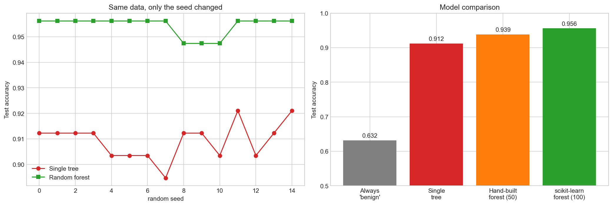
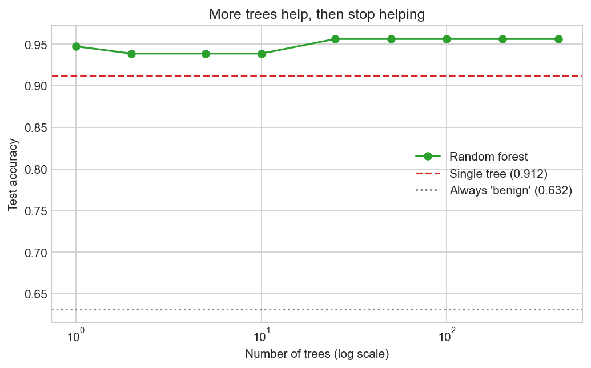
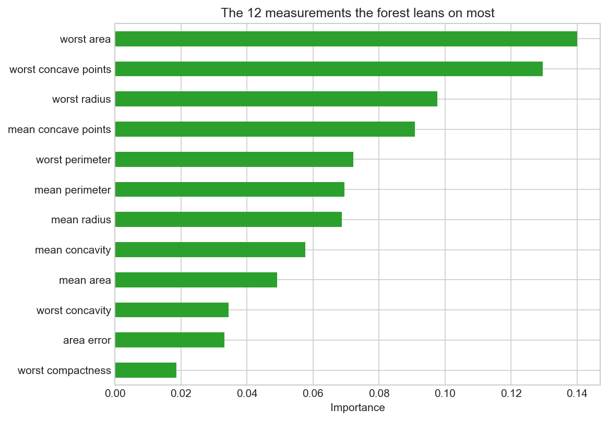

# 09 — Random Forest

> Many deliberately different decision trees, voting together — and beating any one of them.

**Notebook:** [`notebook.ipynb`](notebook.ipynb) — the full working, code, and plots.

---

## What this lesson covers

Lesson 06 built a decision tree and ended by naming its weakness: grown until its
leaves are pure, a tree fits its training data perfectly, and *"a single tree can
change a lot when a few training rows change."*

This lesson measures that weakness, then fixes it. It covers bootstrap sampling,
random feature subsetting, majority voting, how many trees are enough, the
out-of-bag score, and feature importances — building a small forest by hand
first, then handing the job to scikit-learn.

---

## Intuition

Ask one specialist for a diagnosis and you get one opinion, shaped by the cases
that specialist happens to have seen. Ask a hundred and take the majority, and
the individual quirks cancel out.

This only works if **the specialists are not all the same**. A hundred identical
opinions is still one opinion. The committee is useful precisely because its
members disagree.

A random forest manufactures disagreement on purpose:

- **Different patients.** Each tree trains on a bootstrap sample — rows drawn at
  random with replacement, so one tree may see a patient twice and another not at
  all.
- **Different measurements.** At each split a tree may only consider a random
  handful of the features. Without this, every tree would grab the same strongest
  feature first and they would all come out nearly identical.

The counter-intuitive part: making each tree individually *worse* makes the group
*better*.

---

## The mathematics

Prediction error decomposes into three parts:

$$
\text{error} = \underbrace{\text{bias}^2}_{\text{too simple}} + \underbrace{\text{variance}}_{\text{too sensitive to this data}} + \underbrace{\text{noise}}_{\text{irreducible}}
$$

A fully grown tree has **low bias** and **high variance** — it can represent
almost any rule, and it changes shape when the data shifts slightly.

Averaging $B$ predictors that are correlated with each other by $\rho$ gives an
average with variance:

$$
\rho \sigma^2 + \frac{1 - \rho}{B} \sigma^2
$$

The whole method is in that formula:

- More trees drive the **second** term to zero. Extra trees never hurt; they
  simply stop helping.
- The **first** term does not shrink with more trees at all. It is floored by how
  correlated the trees are — which is why the random feature subsetting exists.
  Bootstrapping alone leaves trees that still agree too often.

**Averaging reduces variance, not bias.** That is why forest trees are grown deep
rather than pruned: each should be low-bias and high-variance, and the averaging
handles the variance.

Two settings follow directly: `n_estimators` ($B$, the number of trees) and
`max_features` ($m$, how many features each split may consider — the default
$\sqrt{p}$ is 5 here).

---

## The dataset

| Property | Value |
|---|---|
| **Source** | [Breast Cancer Wisconsin (Diagnostic)](https://archive.ics.uci.edu/dataset/17/breast+cancer+wisconsin+diagnostic), UCI — bundled with scikit-learn |
| **Samples** | 569 biopsies |
| **Features** | 30 measurements of cell nuclei from a digitised biopsy image |
| **Target** | `diagnosis` — 0 = malignant (212), 1 = benign (357) |
| **Split** | 80 / 20, seeded and **stratified** — 455 training, 114 test |
| **Preprocessing** | None |

The 30 features are ten properties — radius, texture, perimeter, area,
smoothness, compactness, concavity, concave points, symmetry, fractal dimension —
each reported three ways: its **mean**, its **standard error**, and its **worst**
(largest) value in the sample.

**No scaling**, unlike lessons 05 and 07. A tree asks "is this value above or
below a threshold", and the answer does not change with the units. Distances and
gradients care about scale; thresholds do not.

**Baseline to beat: 0.632** — the accuracy of ignoring every measurement and
always answering "benign".

---

## What the code does

The notebook works through five steps, each answering the question the previous
one raised.

**1. One tree, as something to beat.** A single unrestricted tree reaches depth 7
and scores **1.0000 on training data, 0.9123 on the test set**. It has not
learned 100% of anything — it has memorised 455 patients.

**2. How fragile is that tree?** The same algorithm on the same data, changing
only the random seed, 15 times. If the problem is variance, the answer should
move around. It does.

**3. A forest built by hand.** Twelve lines: draw a bootstrap sample, pick 5 of
the 30 measurements at random, grow a deep tree, repeat 50 times, take the
majority vote.

**4. The same thing from scikit-learn.** `RandomForestClassifier` with one
refinement — it draws a fresh feature subset at **every split**, not once per
tree, so each tree explores many combinations instead of being locked into five
measurements for its whole depth.

**5. How many trees, and a free validation score.** An `n_estimators` curve, then
the out-of-bag score: each tree misses about 1/e ≈ 37% of patients in its
bootstrap sample, and those left-out patients can score it for free.

---

## Results

| Model | Test accuracy |
|---|---|
| Always answer "benign" | 0.632 |
| Single decision tree | 0.912 |
| One tree on a bootstrap + 5 features | 0.895 |
| Hand-built forest, 50 trees | 0.939 |
| **scikit-learn forest, 100 trees** | **0.956** |

**The method in two numbers.** One tree handicapped with a bootstrap sample and 5
of 30 features scores **0.895** — worse than the full single tree. Fifty such
handicapped trees voting score **0.939** — better than it. Starving the
individuals improved the group.

**The fragility is what gets fixed.** Running each model 15 times with only the
seed changed:

| | Lowest | Highest | Spread | Mean |
|---|---|---|---|---|
| Single tree | 0.895 | 0.921 | **0.026** | 0.909 |
| Random forest | 0.947 | 0.956 | **0.009** | 0.954 |

The forest's spread is about a third of the tree's, and in the left-hand plot
*every* forest run beats *every* tree run. The forest is not merely better on
average — it is **predictably** better, which is what lets you trust a single run
of it.

**Why scikit-learn beats the hand-built version** (0.956 vs 0.939): subsetting
features per split instead of per tree makes the trees differ in more ways, which
pushes down the $\rho$ term that no amount of extra trees can touch.

### How many trees

| Trees | 1 | 2 | 5 | 10 | 25 | 50 | 100 | 200 | 400 |
|---|---|---|---|---|---|---|---|---|---|
| Test accuracy | 0.947 | 0.939 | 0.939 | 0.939 | 0.956 | 0.956 | 0.956 | 0.956 | 0.956 |

The left of this curve is noise, and the lesson says so rather than inventing a
trend: one patient is worth 0.9 points on 114 rows, and a one-tree "forest"
happens to score 0.947 — better than 2, 5 or 10 trees. What is trustworthy is the
right: from 25 trees the score settles at 0.956 and never moves again. That is
the plateau the mathematics predicted.

The **out-of-bag score is 0.954** against a test accuracy of 0.956 — close enough
to be useful for comparing settings without spending test data.

### Which measurements matter

| Measurement | Importance |
|---|---|
| worst area | 0.140 |
| worst concave points | 0.130 |
| worst radius | 0.098 |
| mean concave points | 0.091 |

Size and shape irregularity dominate, and the "worst" variants outrank their
"mean" counterparts — clinically sensible, since what matters is the most
abnormal nucleus in the sample, not the average one. The five least useful
features contribute 0.020 between them.

Two cautions. Several of these are near-duplicates (`worst area`, `worst radius`
and `worst perimeter` describe the same thing), so the forest splits credit
between twins and a useful feature can look unimportant. And importance measures
**use, not cause** — it says the forest found a feature handy for splitting, not
that the property drives the diagnosis.

### Reading the errors

| | precision | recall | support |
|---|---|---|---|
| malignant | 0.951 | 0.929 | 42 |
| benign | 0.959 | 0.972 | 72 |

Three malignant samples were called benign; two benign samples were called
malignant. The counts are similar, the **consequences** are not — a false alarm
means another test, a missed malignancy means an untreated cancer. Recall on the
malignant class (0.929) is the number to watch, and lesson 07's threshold
argument applies directly: lowering the cut-off below 0.5 would catch more
malignancies at the cost of more false alarms, which for this question is usually
the right trade.

**This is a teaching dataset, not a diagnostic tool** — 569 biopsies from one
1990s study, already reduced to clean numeric measurements. Nothing here should
inform a real diagnosis.

### What it costs

A single tree could be printed and read as a rule, the way lesson 06's was. A
hundred trees voting cannot be read at all; feature importances summarise the
forest but explain no individual decision. Where a model must be auditable, that
trade may not be acceptable.

And the ceiling set by the data has not moved. Averaging removes variance, never
bias and never noise. A forest given the wrong features still fails — it just
fails consistently.

---

## References

- Dataset: [Breast Cancer Wisconsin (Diagnostic)](https://archive.ics.uci.edu/dataset/17/breast+cancer+wisconsin+diagnostic),
  UCI Machine Learning Repository, distributed with scikit-learn as
  `sklearn.datasets.load_breast_cancer`.
- Breiman, L. (2001). *Random Forests*. Machine Learning 45(1), 5–32.
- [scikit-learn: Forests of randomized trees](https://scikit-learn.org/stable/modules/ensemble.html#forest)
- Builds directly on [lesson 06 — Decision Trees](../06-decision-trees/).
