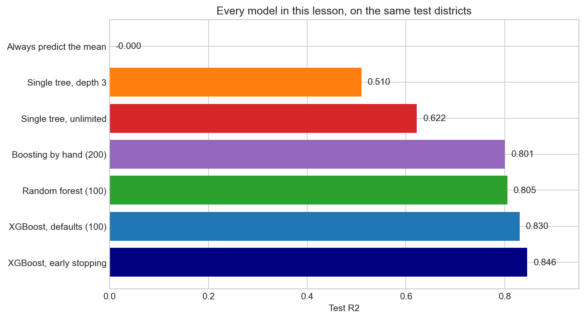
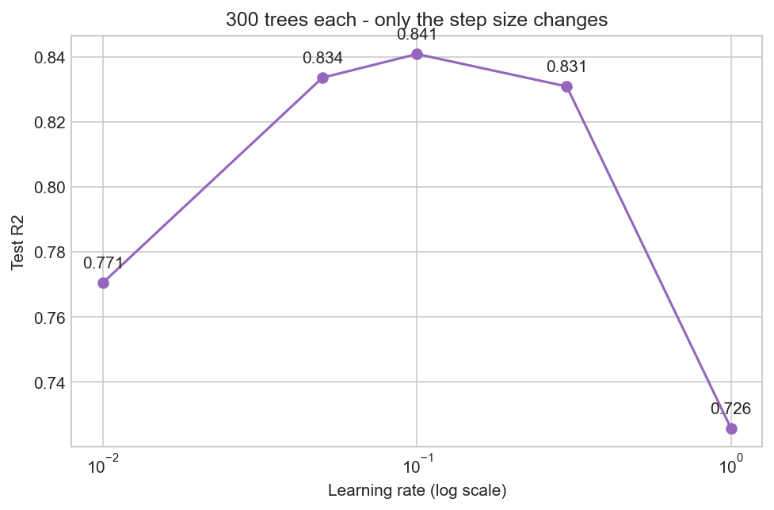
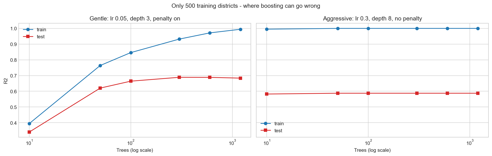
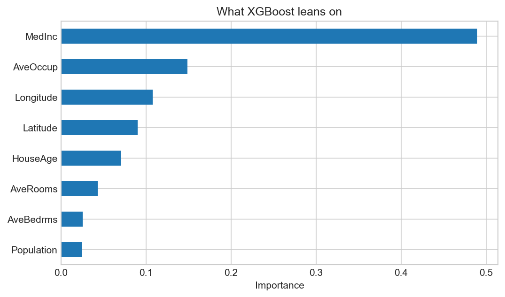

# 10 — XGBoost

> Hundreds of weak trees built one after another, each one correcting the mistakes of the last.

**Notebook:** [`notebook.ipynb`](notebook.ipynb) — the full working, code, and plots.

---

## What this lesson covers

Lesson 09 combined trees by **averaging** them: grow many deep trees
independently, let them vote, and their individual quirks cancel out. This lesson
combines trees the other way — **sequentially**, each new tree fitted to the
errors the previous ones left behind.

It covers why residuals are the thing to fit, why that turns out to be gradient
descent, what XGBoost adds on top, how the learning rate trades against the number
of trees, when more trees start to *hurt*, and how early stopping finds the right
number by itself.

---

## Intuition

A random forest is a **committee voting at the same time**. Every member is strong
on its own and nobody sees anyone else's answer.

Boosting is a **relay team**. The first runner covers some ground badly. The
second does not start over — it looks at where the first fell short and works on
that. Each member is weak alone and is only asked to fix what remains.

1. Predict the average price for every district. Terrible, but a start.
2. Compute the **residuals** — how far off that guess was.
3. Fit a small tree to **the residuals**, not the prices.
4. Add a fraction of that correction.
5. Repeat, hundreds of times.

| | Random forest (09) | Boosting (10) |
|---|---|---|
| Trees built | in parallel, independently | in sequence, each depends on the last |
| Each tree is | deep and strong | shallow and deliberately weak |
| Each tree fits | the target | the **errors left over** |
| Mainly reduces | variance | bias |
| More trees | never hurt | **can** hurt |

---

## The mathematics

After $M$ rounds the model is a sum:

$$
\hat{y}(x) = F_0(x) + \eta \sum_{m=1}^{M} h_m(x)
$$

**Why residuals?** With squared error $L = \frac{1}{2}\sum_i (y_i - \hat{y}_i)^2$,
differentiating with respect to the current prediction gives

$$
\frac{\partial L}{\partial \hat{y}_i} = -(y_i - \hat{y}_i) = -\,\text{residual}_i
$$

The residual **is** the negative gradient. Fitting a tree to the residuals and
adding it is therefore gradient descent — not over parameters as in lesson 07, but
over *functions*. Hence **gradient boosting**: each tree is one downhill step and
$\eta$ is the step size. Swap the loss and "residual" becomes that loss's negative
gradient; the algorithm is otherwise unchanged, which is how the same machinery
covers classification and ranking.

**What XGBoost adds** is a second-order expansion — each tree is chosen using both
the slope $g_i$ and the curvature $h_i$ — plus an explicit complexity penalty:

$$
\sum_i \left( g_i f(x_i) + \tfrac{1}{2} h_i f(x_i)^2 \right) + \gamma T + \tfrac{1}{2}\lambda \sum_j w_j^2
$$

$T$ is the leaf count and $w_j$ the leaf values, so $\gamma$ discourages big trees
and $\lambda$ discourages overconfident leaves — Ridge, applied to trees.

**Why this one can overfit.** A forest's trees never see each other, so more trees
only refine an average. Boosting's trees fit what is left over, and eventually
what is left over is noise.

---

## The dataset

| Property | Value |
|---|---|
| **Source** | California housing, 1990 US census — `sklearn.datasets.fetch_california_housing` |
| **Samples** | 20,640 census block groups |
| **Features** | `MedInc`, `HouseAge`, `AveRooms`, `AveBedrms`, `Population`, `AveOccup`, `Latitude`, `Longitude` |
| **Target** | `MedHouseVal` — median house value, in units of $100,000 |
| **Split** | 80 / 20, seeded — 16,512 training, 4,128 test |
| **Preprocessing** | None |

A **regression** problem on purpose: boosting fits residuals, and residuals are
far easier to follow as literal dollar amounts than as classification margins.

**The target is capped at 5.00.** 992 districts — 4.8% of the data — were worth
more than $500,000 and were all recorded as exactly $500,000. That ceiling was
imposed when the data was collected, and it shows up in the results below.

**Baseline to beat: R² ≈ 0.000, MAE $90,607** — the score of always predicting the
training mean.

---

## What the code does

**5.1 — one weak tree.** A depth-3 tree scores R² 0.510. This is the "weak
learner" boosting is assembled from.

**5.2 — the concept, by hand.** Eight lines: start at the mean, compute residuals,
fit a depth-3 tree to *the residuals*, add 0.1 × its prediction, repeat 200 times.

**5.3 — the same thing from XGBoost**, with the second-order objective and
penalties, in C++.

**5.4 — the learning rate**, swept across five values at a fixed 300 trees.

**5.5 — when more trees hurt**, by shrinking the training set to 500 districts and
comparing gentle against aggressive settings.

**5.6 — early stopping**, on a validation slice carved out of the *training* data,
never the test set.

---

## Results

| Model | Test R² | MAE |
|---|---|---|
| Always predict the mean | −0.000 | $90,607 |
| Single tree, depth 3 | 0.510 | $59,783 |
| Single tree, unlimited | 0.622 | $45,468 |
| Boosting by hand, 200 trees | 0.801 | — |
| Random forest, 100 trees *(lesson 09's method)* | 0.805 | — |
| XGBoost, defaults, 100 trees | 0.830 | — |
| **XGBoost, early stopping (937 trees)** | **0.846** | **$29,345** |

**The clearest single number in the lesson** is the first line of the hand-built
loop. In lesson 09, the forest's very first tree already scored **0.895** — a
complete model on its own. Here the first tree scores **0.098**, barely better
than guessing the mean, because it was never asked to predict a price. It was
asked to predict a correction.

| Trees | 1 | 5 | 25 | 50 | 100 | 200 |
|---|---|---|---|---|---|---|
| Test R² | 0.098 | 0.353 | 0.667 | 0.744 | 0.776 | 0.801 |

Two hundred deliberately feeble trees, summed, beat one unlimited tree (0.622) and
draw level with a hundred-tree random forest.

**Speed is the surprise.** XGBoost reached 0.830 in **0.20 seconds**; the random
forest reached 0.805 in **2.44 seconds**. Roughly twelve times faster *and* more
accurate, because shallow depth-6 trees with histogram-based splitting are far
less work than 100 trees grown to full depth.

(Those two timings are wall-clock on one machine and are the only numbers in this
repository that will not reproduce exactly elsewhere. The ratio between them is
the point, not the absolute seconds.)

### The learning rate

| η | 0.01 | 0.05 | **0.1** | 0.3 | 1.0 |
|---|---|---|---|---|---|
| Test R² | 0.771 | 0.834 | **0.841** | 0.831 | 0.726 |

A clear peak, with real damage at both ends. At 0.01 the model has not finished
arriving within 300 trees; at 1.0 each tree overcorrects and they fight one
another. This is the first setting in this repository where "more is better" does
not hold — η and `n_estimators` trade against each other, and halving one roughly
doubles the other.

### When more trees hurt

With all 16,512 training districts there is enough signal that extra trees simply
stop helping. On **500** districts, the difference appears:

| Trees | 10 | 50 | 100 | **300** | 600 | 1200 |
|---|---|---|---|---|---|---|
| Train R² | 0.394 | 0.764 | 0.846 | 0.932 | 0.971 | 0.994 |
| Test R² | 0.340 | 0.620 | 0.664 | **0.689 ← peak** | 0.688 | 0.684 |

Test R² peaks around 300 trees and then drifts **down** while train R² climbs
toward 1.0. That downturn is the thing a random forest cannot do.

The right-hand panel is the more striking half. The same 500 districts with
aggressive settings (η 0.3, depth 8, no penalty) memorise everything within about
**ten** trees — train R² is already 1.0 — and test R² is stuck at 0.588, more than
ten points below what the gentle settings eventually reach. Adding trees after
that changes nothing: there is no error left to fit, and the damage was done in
the first few rounds.

That comparison is the whole argument for a small learning rate, shallow trees and
the penalty terms. They are not caution for its own sake; they stop the model
spending its capacity on noise.

### Which features matter

| Feature | Importance |
|---|---|
| MedInc | 0.490 |
| AveOccup | 0.149 |
| Longitude | 0.108 |
| Latitude | 0.090 |

Median income dominates. The interesting entry is **geography**: latitude and
longitude together carry about 0.20 — more than any single feature except income —
because the trees use them to carve California into regions, coastal against
inland, Bay Area against Central Valley. The Tehran project had to be *told* about
neighbourhoods through one-hot encoding; here the trees discover the map by
splitting on coordinates repeatedly.

As in lesson 09: importance records what the model *used*, not what *causes*
prices, and correlated features share credit.

### Where it fails

| | Mean absolute error |
|---|---|
| The 184 test districts at the $500k cap | **$62,251** |
| Everywhere else | **$27,810** |

The model's error on capped districts is more than twice its error elsewhere, and
the predicted-against-actual plot shows them as a flat stripe along the top. Those
districts share one recorded value and genuinely different real values, so the
model is penalised for predicting anything but exactly 5.0.

That is not a modelling failure — it is a measurement limit baked into the data in
1990, and no algorithm can see past it. The honest options are to exclude the
capped districts or to report their error separately, as above.

---

## What it gained, and what it cost

**Gained over lesson 09:** better accuracy, much faster fitting, and headroom —
XGBoost kept improving as it was tuned (0.830 → 0.846), where a forest is near its
ceiling out of the box.

**Cost:**

- **Settings that matter.** A forest works at its defaults; here η, depth and tree
  count interact, and bad choices cost ten points.
- **A real way to go wrong.** More trees can make a boosted model worse —
  impossible for a forest.
- **An extra dependency.** XGBoost is not part of scikit-learn.

**Which to reach for.** A random forest is the better first thing to try: nearly
impossible to misconfigure, and it tells you quickly whether the features carry
signal at all. Boosting is for when that signal exists and the last few points
matter — which is why gradient boosting wins most tabular competitions while
random forests remain the sensible default.

Neither moves the ceiling the data sets. Both are stopped by the same $500,000
cap.

---

## References

- Dataset: California housing, 1990 US census, via
  `sklearn.datasets.fetch_california_housing`. Originally Pace, R. K. and
  Barry, R. (1997), *Sparse Spatial Autoregressions*.
- Chen, T. and Guestrin, C. (2016). *XGBoost: A Scalable Tree Boosting System*.
- Friedman, J. (2001). *Greedy Function Approximation: A Gradient Boosting
  Machine*.
- [XGBoost documentation](https://xgboost.readthedocs.io/en/stable/)
- Builds directly on [lesson 09 — Random Forest](../09-random-forest/).
