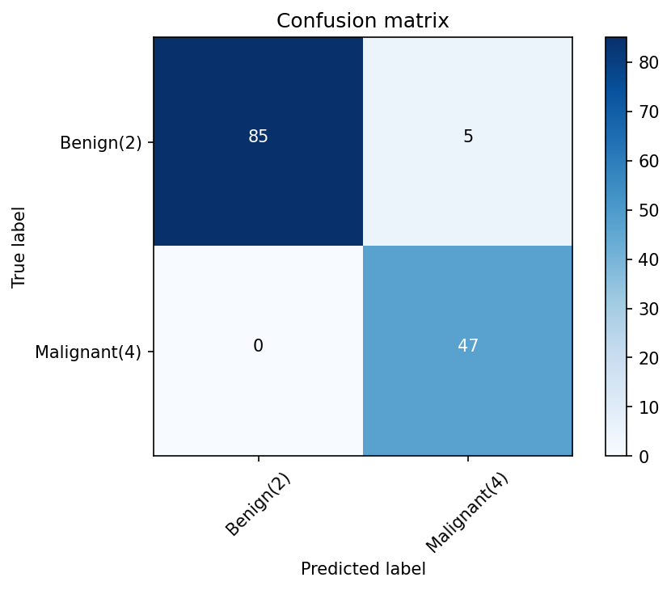

# 11 — Support Vector Machines

> Separating two classes with the widest possible gap — and bending that gap with a kernel when a straight one will not do.

**Notebook:** [`notebook.ipynb`](notebook.ipynb) — the full working, code, and plots.

---

## What this lesson covers

Logistic regression (lesson 07) draws a boundary by making the observed labels
as probable as possible. A support vector machine draws it by **geometry**: of
all the boundaries that separate the classes, take the one with the widest empty
margin on either side.

This lesson covers the margin, the soft margin and its `C` parameter, support
vectors, and the kernel trick. It then applies an RBF-kernel SVM to classify
biopsy samples as benign or malignant and tests whether a plain linear boundary
does just as well.

---

## Intuition

Many lines separate two clouds of points. A line squeezed against one cloud will
misclassify the next point that lands slightly on the wrong side. A line through
the middle of the widest gap has the most room for error on both sides.

- **Support vectors.** Only the points on the edge of the margin decide where the
  boundary goes. Every other point could move — as long as it stays outside the
  margin — without changing anything.
- **Kernels.** A kernel measures similarity in a way that corresponds to a richer
  feature space. A flat boundary in that space is a curved one in the original,
  so the same method can fit non-linear problems.

---

## The mathematics

With classes encoded as $y_i \in \{-1, +1\}$, the boundary is
$w^\top x + b = 0$. Scaling so the nearest points sit at $w^\top x + b = \pm 1$
makes the margin width $2 / \lVert w \rVert$, so widening the margin means
shrinking $\lVert w \rVert$.

Real data overlaps, so each point gets a slack $\xi_i \ge 0$ and the slack is
penalised — the **soft-margin** problem:

$$
\min_{w,\,b,\,\xi} \; \tfrac{1}{2}\lVert w \rVert^2 + C \sum_i \xi_i
\quad \text{subject to} \quad y_i (w^\top x_i + b) \ge 1 - \xi_i, \;\; \xi_i \ge 0
$$

$C$ is the trade-off. Large $C$ tolerates few violations and hugs the training
data; small $C$ accepts violations in return for a wider, simpler margin.

The solution depends on the data only through dot products, so the classifier
can be written as

$$
f(x) = \operatorname{sign}\Big( \sum_{i \in SV} \alpha_i \, y_i \, K(x_i, x) + b \Big)
$$

summing over support vectors only. Swapping in a kernel $K$ changes the shape of
the boundary:

| Kernel | $K(x, x')$ | Boundary |
|---|---|---|
| Linear | $x^\top x'$ | flat hyperplane |
| Polynomial | $(\gamma\, x^\top x' + r)^d$ | polynomial surface |
| RBF | $\exp(-\gamma \lVert x - x' \rVert^2)$ | any smooth shape |
| Sigmoid | $\tanh(\gamma\, x^\top x' + r)$ | neural-network-like |

---

## The dataset

| Property | Value |
|---|---|
| **Source** | [Breast Cancer Wisconsin (Original)](https://archive.ics.uci.edu/dataset/15/breast+cancer+wisconsin+original), UCI |
| **Samples** | 699 biopsies; 683 after removing 16 with a missing `BareNuc` |
| **Features** | 9 cell properties, each graded 1–10 (clump thickness, uniformity of size and shape, marginal adhesion, epithelial cell size, bare nuclei, bland chromatin, normal nucleoli, mitoses) |
| **Target** | `Class` — 2 = benign, 4 = malignant |
| **Split** | 80 / 20, `random_state=4` — 546 training, 137 test |
| **Preprocessing** | Rows with `BareNuc = "?"` dropped; no scaling |

**No scaling.** SVMs measure distances, so a feature with a large range would
normally swamp the others — the reason lesson 05 scaled its features. Here every
feature is already a grade on the same 1-to-10 scale.

This is a different dataset from lesson 09's breast-cancer data: there, 30
continuous measurements from a digitised image; here, nine grades assigned by a
pathologist.

**Baseline to beat: 0.657** — the accuracy of always answering "benign" on the
test set (90 of 137 samples).

---

## What the code does

1. **Load and inspect** — a scatter of clump thickness against uniformity of cell
   size shows malignant samples concentrated at the high end of both.
2. **Clean** — `BareNuc` is read as text because 16 entries are `?`. Those rows
   are dropped and the column converted to integers.
3. **Split** 80/20.
4. **Fit an RBF-kernel SVM** with scikit-learn's defaults ($C = 1$).
5. **Evaluate** with a classification report, a confusion matrix, and the
   Jaccard index.
6. **Refit with a linear kernel** and compare.

---

## Results

| Model | Accuracy | Weighted F1 | Jaccard (benign) |
|---|---|---|---|
| Always answer "benign" | 0.657 | — | — |
| **SVM, RBF kernel** | **0.964** | **0.964** | **0.944** |
| **SVM, linear kernel** | — | **0.964** | **0.944** |

| | precision | recall | support |
|---|---|---|---|
| benign (2) | 1.00 | 0.94 | 90 |
| malignant (4) | 0.90 | **1.00** | 47 |

**Every malignant sample was caught.** All five errors are benign samples
flagged as malignant. For a screening problem this is the right direction to be
wrong in: a false alarm costs another test, a missed malignancy is the error
that matters.

**The linear kernel matches RBF** to four decimal places on both F1 and the
Jaccard index. The extra flexibility of RBF bought nothing, which says something
about the data rather than about RBF: benign and malignant samples are separated
about as well by a flat boundary as by any curved one. With equal performance,
the linear model is the better choice — simpler to explain, and its nine weights
can be read directly.

**A note on the Jaccard index.** It is computed with `pos_label=2`, so it
measures agreement on the **benign** class — not the malignant class, which is
the one a screening test exists to find.

### Limits

- **A small test set.** One sample moves accuracy by about 0.7 percentage points,
  so small differences between models would not be meaningful.
- **Duplicate rows.** 8 rows appear twice, `ID` included — the same sample
  recorded twice. They are kept, as in the original lab, so a few samples may
  appear in both the training and the test set.
- **Default settings.** $C$ and $\gamma$ were left at scikit-learn's defaults,
  not tuned.
- **A teaching dataset, not a diagnostic tool.** Nothing here should inform a
  real diagnosis.

---

## References

- Dataset: [Breast Cancer Wisconsin (Original)](https://archive.ics.uci.edu/dataset/15/breast+cancer+wisconsin+original),
  UCI Machine Learning Repository. Wolberg, W. H. and Mangasarian, O. L. (1990).
- Course: Machine Learning with Python (Jadi), based on the IBM / Cognitive Class
  SVM lab.
- Cortes, C. and Vapnik, V. (1995). *Support-Vector Networks*. Machine Learning
  20(3), 273–297.
- [scikit-learn: Support Vector Machines](https://scikit-learn.org/stable/modules/svm.html)
