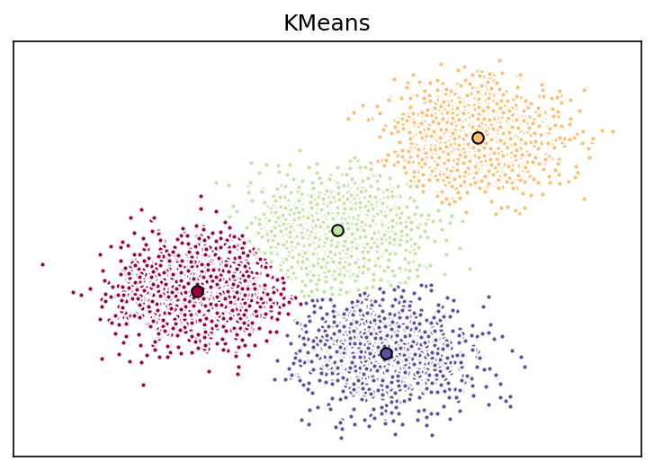
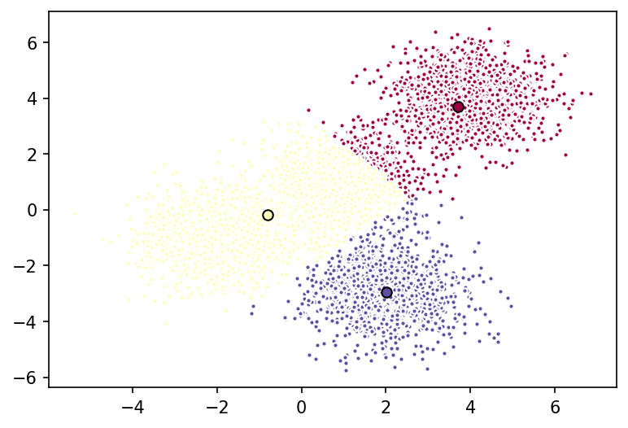
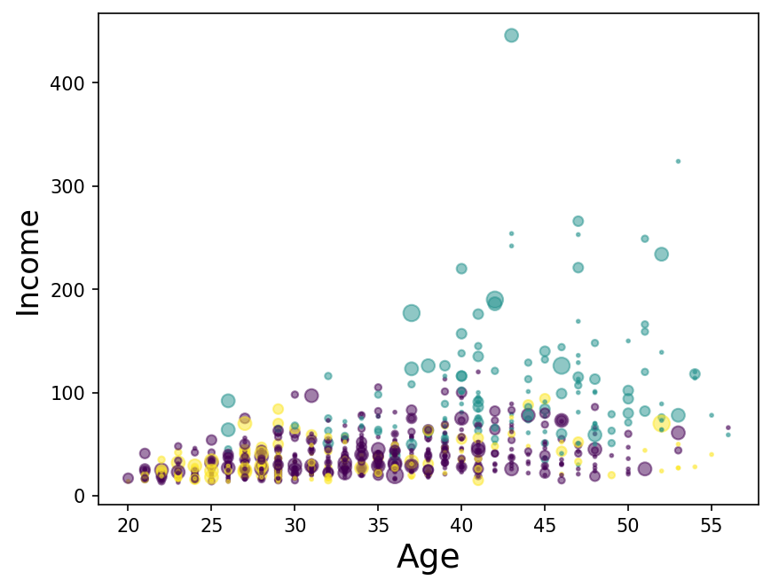

# 12 — K-Means Clustering

> Finding groups in data that nobody has labelled — and checking whether the groups mean what they appear to mean.

**Notebook:** [`notebook.ipynb`](notebook.ipynb) — the full working, code, and plots.

---

## What this lesson covers

Lessons 01–11 were all **supervised**: every row came with the right answer, and
the model learned to reproduce it. This is the first **unsupervised** lesson.
There is no answer column — only the question of whether the rows fall into
natural groups.

It covers the k-means algorithm and the objective it minimises, why it needs
k-means++ initialisation and several restarts, what happens when $k$ is chosen
wrongly, and why scaling decides the result. It then segments 850 bank customers
and checks what the segments actually represent.

---

## Intuition

Pick a number of groups, $k$, and place $k$ centroids among the data. Then
repeat:

1. **Assign** — every point joins its nearest centroid.
2. **Update** — every centroid moves to the mean of the points that joined it.

Stop when nothing changes. Three things follow from that recipe:

- **$k$ is chosen by you**, and the algorithm never objects to a bad choice.
- **"Nearest" is straight-line distance**, so unscaled features with large
  numbers dominate.
- **The start matters**, so the algorithm is run several times.

---

## The mathematics

K-means minimises the **inertia** — the total squared distance from each point
to the centroid of its own cluster:

$$
J = \sum_{j=1}^{k} \sum_{x \in C_j} \lVert x - \mu_j \rVert^2
$$

Each step can only lower $J$. With centroids fixed, assigning each point to its
nearest centroid is optimal; with clusters fixed, the optimal centroid is the
mean, $\mu_j = \frac{1}{|C_j|}\sum_{x \in C_j} x$. Since $J$ never rises and the
number of possible partitions is finite, the algorithm always stops — at a
**local** minimum.

That is why two settings exist:

- **`k-means++`** chooses each new starting centroid with probability
  proportional to its squared distance from the centroids already chosen,
  spreading the starts out.
- **`n_init=12`** runs the algorithm 12 times and keeps the lowest $J$.

Minimising squared Euclidean distance favours **round clusters of similar
spread**, and only makes sense for features where distance means something.

---

## The datasets

**Part 1 — generated data.** 5,000 points from `make_blobs`, around four known
centres — $(4, 4)$, $(-2, -1)$, $(2, -3)$, $(1, 1)$ — with standard deviation
0.9. Because the truth is known, the result can be checked.

**Part 2 — customer segmentation.**

| Property | Value |
|---|---|
| **Source** | `Cust_Segmentation.csv`, as supplied with the course |
| **Rows** | 850 bank customers |
| **Features used** | `Age`, `Edu` (1–5), `Years Employed`, `Income`, `Card Debt`, `Other Debt` (all in thousands of dollars), `Defaulted` (0/1), `DebtIncomeRatio` (%) |
| **Dropped** | `Customer Id` (an identifier), `Address` (a code, meaningless as a distance) |
| **Missing** | `Defaulted` is blank for 150 customers |
| **Preprocessing** | Missing values filled with 0; all features standardised |

---

## What the code does

1. **Generated data, $k = 4$.** Fit k-means and compare the centroids with the
   true centres.
2. **Generated data, $k = 3$.** Ask for the wrong number of clusters and see what
   comes back.
3. **Customers.** Drop `Address`, fill the missing `Defaulted` values, scale,
   and fit k-means with $k = 3$.
4. **Profile** each cluster by averaging its features in the original units.

---

## Results

### On generated data

With $k = 4$, every centroid lands within about **0.04** of a true centre.

With $k = 3$, k-means returns three clusters without complaint. The two
well-separated groups keep a cluster each; the two closest groups, around
$(-2, -1)$ and $(1, 1)$, are merged into one, with a single centroid between
them that describes neither. **K-means always finds exactly $k$ clusters,
whether or not they exist.** Here the mistake is visible; with eight features it
would not be.

### On the customers

| Cluster | Customers | Age | Income ($k) | Years employed | Debt-to-income | Defaulted |
|---|---|---|---|---|---|---|
| 0 | 537 | 33.8 | 36.1 | 7.6 | 7.96% | 0.00 |
| 1 | 147 | 43.0 | 102.0 | 17.2 | 13.92% | 0.16 |
| 2 | 166 | 31.9 | 31.8 | 4.0 | 13.99% | 0.99 |

- **Cluster 1 — established and affluent.** Oldest, longest employed, about three
  times the income of the others. Largest debts in absolute terms, but carried:
  16% have defaulted.
- **Cluster 0 — young, modest income, low debt, no defaults.** The largest group,
  with about half the debt-to-income ratio of the others.
- **Cluster 2 — young, modest income, heavily indebted, defaulted.** Nearly the
  same age and income as cluster 0, but newer in work, with almost twice the
  relative debt, and 99% defaulted.

**The plot shows the key point.** Cluster 1 (teal) stands apart at the top;
clusters 0 (purple) and 2 (yellow) lie on top of each other across the whole
age and income range. What separates them is in the table: **`Defaulted` —
0.00 against 0.99.**

### What that means

1. **A yes/no column dominated the clustering.** After standardisation,
   `Defaulted` takes only two values far apart, and that gap outweighs most
   differences on the continuous features. It is the same reason `Address` was
   dropped — a category is not a distance — but `Defaulted` was kept.
2. **150 customers were placed by a guess.** Their unknown default status was
   filled with 0, recording them as non-defaulters and pushing them toward
   cluster 0. The model did not learn they were safe; it was told.

The segmentation is still useful — whether a customer has defaulted is a real and
commercially important distinction — but it is a segmentation by **credit
behaviour**, not by the age and income the course lab describes. And the
grouping of the 150 unknown-status customers should not be trusted.

### Limits

- **$k = 3$ is assumed, not tested.** Part 1 shows k-means will return any $k$ it
  is given; nothing here checks whether 3 suits the customers.
- **The cluster numbers are arbitrary.** They are stable here only because the
  generator is seeded; a different seed could number the same groups
  differently.
- **No ground truth.** Unlike every earlier lesson, there is no test score.
  Whether a clustering is good is judged by whether its groups are coherent and
  useful — which is why the profiling step matters more than the fit.

---

## References

- Dataset: `Cust_Segmentation.csv`, as supplied with the course.
- Course: Machine Learning with Python (Jadi), based on the IBM / Cognitive Class
  k-means lab.
- Lloyd, S. P. (1982). *Least Squares Quantization in PCM*. IEEE Transactions on
  Information Theory 28(2), 129–137.
- Arthur, D. and Vassilvitskii, S. (2007). *k-means++: The Advantages of Careful
  Seeding*. Proceedings of SODA 2007.
- [scikit-learn: K-means](https://scikit-learn.org/stable/modules/clustering.html#k-means)
