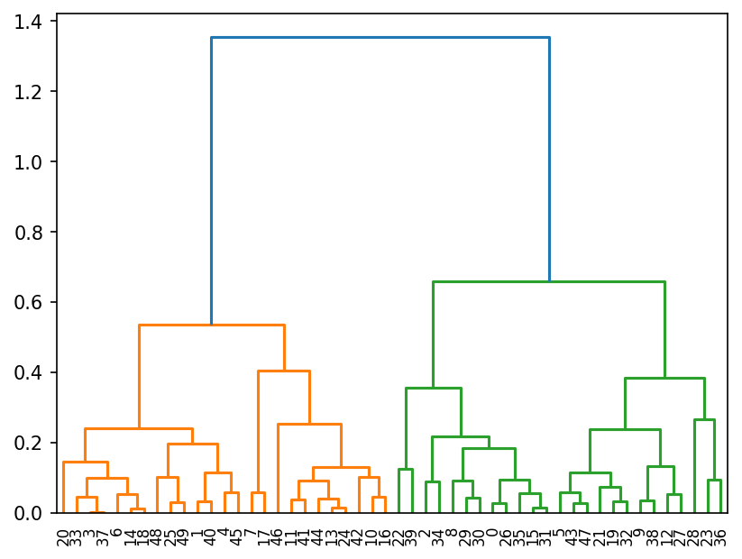
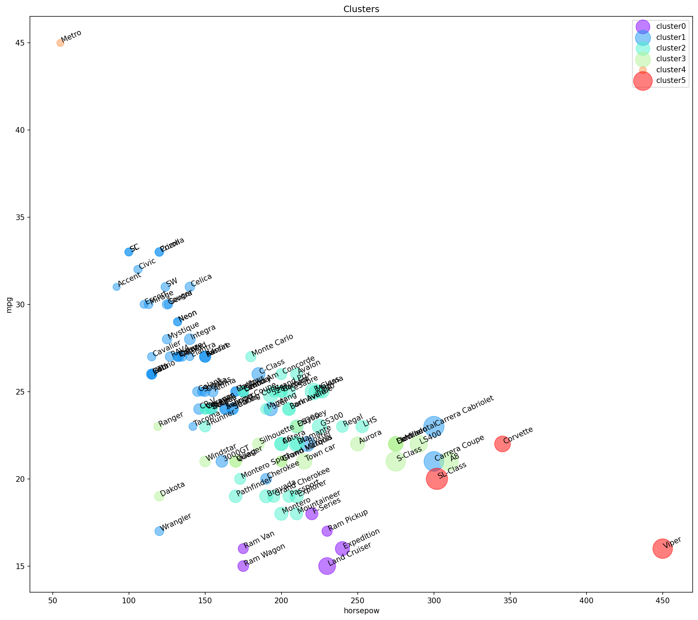

# 13 — Hierarchical Clustering

> Building a whole family tree of groups, from single points up to one cluster, and choosing where to cut it afterwards.

**Notebook:** [`notebook.ipynb`](notebook.ipynb) — the full working, code, and plots.

---

## What this lesson covers

K-means (lesson 12) needed the number of clusters before it started and returned
one flat answer. Hierarchical clustering returns **every** answer at once: a tree
of nested groups, from each point on its own up to everything in one cluster.
The number of clusters is chosen afterwards, by deciding where to cut the tree.

This lesson covers agglomerative clustering, the four common linkage criteria,
distance matrices and the condensed form SciPy expects, and how to read a
dendrogram. It then groups 117 vehicles by their specifications and checks
whether the groups mean anything.

---

## Intuition

Start with every point as its own cluster. Merge the two closest clusters.
Repeat until one remains. With $n$ points that is $n - 1$ merges, and their
record is a **dendrogram**: leaves are points, each joint is a merge, and its
height is the distance at which the merge happened.

A horizontal cut through the dendrogram turns it into a flat clustering — every
branch the cut crosses becomes one cluster. Cut low for many tight clusters,
high for a few broad ones.

---

## The mathematics

"The two closest clusters" requires a distance between **groups** of points —
the **linkage**:

| Linkage | Distance between clusters $A$ and $B$ | Tends to produce |
|---|---|---|
| Single | $\min_{a \in A,\, b \in B} d(a, b)$ | long chains |
| Complete | $\max_{a \in A,\, b \in B} d(a, b)$ | compact clusters of similar diameter |
| Average | $\frac{1}{\lvert A\rvert \lvert B\rvert} \sum_{a,b} d(a, b)$ | a compromise |
| Ward | increase in within-cluster variance from merging | round clusters, like k-means |

All merge decisions come from the $n \times n$ distance matrix
$D_{ij} = d(x_i, x_j)$. It is symmetric with a zero diagonal, so only the
$n(n-1)/2$ entries above the diagonal carry information — the **condensed**
form that `scipy.cluster.hierarchy.linkage` expects, produced by `squareform`.

Storing $D$ alone takes $n^2$ numbers, so hierarchical clustering suits
thousands of rows, not millions.

---

## The datasets

**Part 1 — generated data.** 50 points from `make_blobs` around four centres,
$(4, 4)$, $(-2, -1)$, $(1, 1)$ and $(10, 4)$, standard deviation 0.9,
`random_state=0`.

**Part 2 — vehicles.**

| Property | Value |
|---|---|
| **Source** | `cars_clus.csv`, as supplied with the course |
| **Rows** | 159 vehicles; 117 after removing rows with missing values |
| **Features** | `engine_s`, `horsepow`, `wheelbas`, `width`, `length`, `curb_wgt`, `fuel_cap`, `mpg` |
| **Held out for checking** | `price` and `type` (0 = car, 1 = truck) |
| **Preprocessing** | `$null$` strings converted to missing values and dropped; features scaled to 0–1 with `MinMaxScaler` |

---

## What the code does

1. **Generated data** — cluster with `AgglomerativeClustering` (average
   linkage, 4 clusters), then build complete- and average-linkage dendrograms.
2. **Vehicles** — clean the `$null$` values, select eight specifications, look
   at their correlations, and scale them.
3. **Distance matrix** — computed once by hand with two loops, then again with
   `euclidean_distances`.
4. **Dendrogram** of all 117 vehicles, labelled by manufacturer and model.
5. **Cut into 6 clusters** with `AgglomerativeClustering(metric='precomputed')`,
   then profile each cluster by type.

---

## Results

### On generated data

Cut at four branches, the clustering puts **48 of 50 points** with their true
group. The two exceptions come from the group at $(-2, -1)$ and land with the
group at $(1, 1)$ — the two closest centres, whose points overlap.

The tree also shows something a flat method would hide: its largest vertical gap
is just below the final merge (about 0.66 to 1.35), so judged by the tree alone
the most natural cut gives **two** groups, not four. The dendrogram offers every
answer; which one is right depends on the question.

### On the vehicles

| Cluster | Vehicles | Typical models | Horsepower | Engine (L) | mpg | Price ($k) |
|---|---|---|---|---|---|---|
| 4 | 1 car | Metro | 55 | 1.0 | 45.0 | 9.2 |
| 1 | 47 cars, 5 trucks | Integra, A4, Cavalier, Malibu | 146 | 2.2 | 27.0 | 20.3 |
| 2 | 27 cars, 11 trucks | TL, A6, 528i, Century | 203 | 3.3 | 24.2 | 27.8 |
| 3 | 10 cars, 7 trucks | A8, DeVille, Crown Victoria, Dakota | 257 | 4.4 | 21.5 | 42.9 |
| 5 | 3 cars | Corvette, Viper, SL-Class | 366 | 6.2 | 19.3 | 66.0 |
| 0 | 6 trucks | Ram, F-Series, Expedition, Land Cruiser | 212 | 4.5 | 16.2 | 29.0 |

*Figures for mixed clusters are for their cars.*

**The clusters rank the market by price — without seeing price.** Clusters
4 → 1 → 2 → 3 → 5 form a ladder of rising power, engine size and price, from
\$9k to \$66k. Price was held out, so this is evidence that the grouping
reflects something real. Cluster 0, the full-size trucks and SUVs, sits off the
ladder: heavy rather than fast, with the worst fuel economy of any group.

**Size outvotes power.** Five of the eight features measure how big a vehicle
is. The Porsche Carrera Coupé and Cabriolet, at 300 horsepower, land in cluster
1 with the economy cars because they are small and light. Choosing the features
is choosing what "similar" means.

**Type is not recovered.** Trucks appear in four of the six clusters. A minivan
or compact pickup is closer, by these measurements, to a mid-size car than to an
F-Series; only the heaviest trucks form a group of their own.

**Two clusters are tiny.** The Metro is alone and the three sports cars form a
trio. Complete linkage keeps outliers apart until late, which is useful for
spotting them — but it means "six clusters" is really four groups and two
special cases.

---

## A correction to the original lab

The course lab passed the square distance matrix straight to
`hierarchy.linkage` and to `AgglomerativeClustering`. Both treat a 2-D array as
**rows of features**, so each vehicle was described by its list of distances to
all 117 vehicles, and the algorithm measured distances between those lists — a
distance of distances. SciPy raises a `ClusterWarning` saying exactly this.

This lesson passes the matrix in the form each function expects —
`squareform(dist_matrix)` for SciPy, `metric='precomputed'` for scikit-learn —
and both then agree exactly with clustering the features directly. The
correction changes the result: under the original version, for instance, the
Dodge Viper was grouped with Ram pickups and vans.

---

## Limits

- **Six clusters is a choice.** Nothing in the data dictates it; another cut of
  the dendrogram gives a different, equally valid segmentation.
- **Correlated features.** Most of the eight features measure size, so size
  dominates the distances.
- **No ground truth.** As with k-means, the only check is whether the groups are
  coherent — here, how well they line up with the held-out price and type.

---

## References

- Dataset: `cars_clus.csv`, as supplied with the course.
- Course: Machine Learning with Python (Jadi), based on the IBM / Cognitive Class
  hierarchical clustering lab.
- Müllner, D. (2011). *Modern Hierarchical, Agglomerative Clustering
  Algorithms*. arXiv:1109.2378.
- [SciPy: `scipy.cluster.hierarchy`](https://docs.scipy.org/doc/scipy/reference/cluster.hierarchy.html)
- [scikit-learn: Hierarchical clustering](https://scikit-learn.org/stable/modules/clustering.html#hierarchical-clustering)
