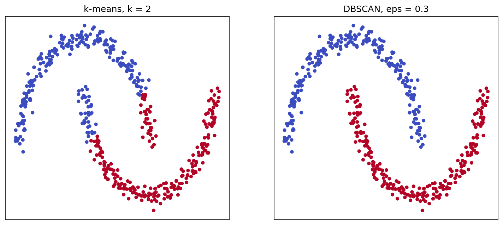
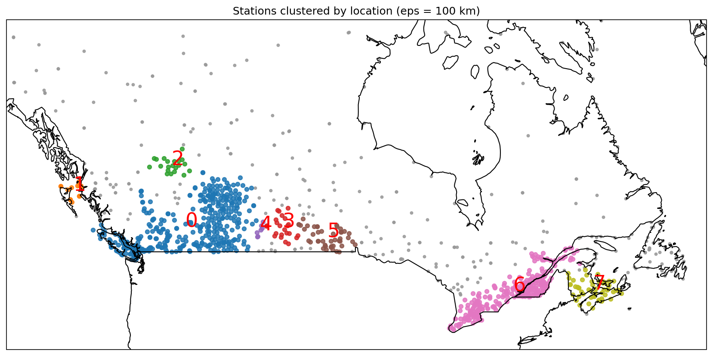
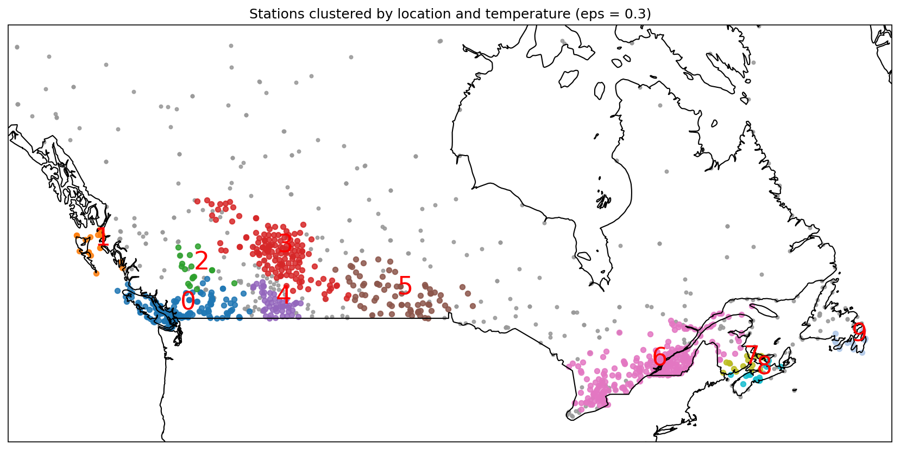
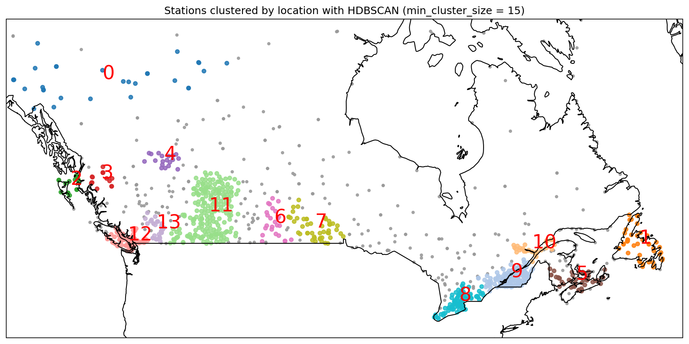

# 14 — DBSCAN

> Clusters as crowded regions separated by empty space — any shape, any number, and an honest label for the points that belong nowhere.

**Notebook:** [`notebook.ipynb`](notebook.ipynb) — the full working, code, and plots.

---

## What this lesson covers

K-means (lesson 12) and hierarchical clustering (lesson 13) force every point
into some cluster, and k-means can only draw round clusters. DBSCAN does
neither. It defines a cluster as a **dense region** — so clusters can take any
shape — and labels points in empty space as **noise** instead of assigning them.

This lesson covers core, border and noise points, density-reachability, how to
choose $\varepsilon$ with a k-distance plot, and why geographic coordinates need
the haversine distance. It compares DBSCAN with k-means on data each one suits,
then clusters 1,189 Canadian weather stations — by location, and by location and
temperature together. It ends with a short look at **HDBSCAN**, the modern
successor that removes DBSCAN's main limitation.

---

## Intuition

Draw a circle of radius $\varepsilon$ around each point and count its
neighbours:

- **Core point** — at least `min_samples` points in the circle: inside a crowd.
- **Border point** — fewer, but within a core point's circle: the edge of a crowd.
- **Noise** — neither.

A cluster grows by chaining from core point to core point. The chain can bend in
any direction, so the cluster can take any shape; and noise is never reached, so
it is left out rather than forced in. The number of clusters is not an input —
it is a result.

---

## The mathematics

With $N_\varepsilon(p) = \{\, q : d(p, q) \le \varepsilon \,\}$:

- $p$ is a **core point** if $\lvert N_\varepsilon(p) \rvert \ge \text{min\_samples}$.
- $q$ is **density-reachable** from $p$ if a chain of core points, each within
  $\varepsilon$ of the next, leads from $p$ to $q$.
- A **cluster** is a maximal set of points that are density-connected — reachable
  from a common core point. Everything else is **noise**.

**Choosing $\varepsilon$:** plot every point's distance to its $k$-th nearest
neighbour ($k$ = `min_samples`), sorted. Clustered points have small values,
noise large ones; $\varepsilon$ goes where the curve turns upward.

**Distance on the Earth:** a degree of longitude shrinks toward the poles, so
raw latitude and longitude are not a flat grid. The **haversine** distance gives
the true distance over the surface:

$$
d = 2R \arcsin \sqrt{ \sin^2\!\frac{\Delta\varphi}{2} + \cos\varphi_1 \cos\varphi_2 \sin^2\!\frac{\Delta\lambda}{2} }
$$

scikit-learn's haversine metric works in radians and returns $d / R$, so
$\varepsilon = 100$ km is passed as $100 / 6371$.

---

## The datasets

| Part | Data |
|---|---|
| Generated blobs | 1,500 points around three centres, `make_blobs`, `random_state=0`, standardised |
| Generated moons | 500 points in two interleaving half-circles, `make_moons`, `random_state=0`, standardised |
| Weather stations | Environment Canada monthly summaries, one winter month of 2014 — 1,341 stations; 1,189 after dropping those without a mean temperature or outside the map |

The course lab labels the weather data "July 2015". The file name says 2014, and
the temperatures — means from −36 °C to +10 °C — show a winter month.

---

## Results

### DBSCAN against k-means

On three round, well-separated blobs, both methods recover the groups exactly.
DBSCAN finds 3 clusters without being told the number, with 1,498 core points,
2 border points and no noise.

On two interleaving moons, **k-means cuts straight across both** — its boundary
between two centroids is always a straight line — while **DBSCAN follows each
crescent exactly**. DBSCAN is not a better k-means; it answers a different
question: *where are the crowds?* rather than *where are the centres?*

### Weather stations by location

The k-distance plot puts the median distance from a station to its 10th-nearest
neighbour at 88 km, with no single sharp elbow. $\varepsilon$ = **100 km** with
`min_samples` = 10 sits on the gentle part of the curve — and is a distance
anyone can picture.

| Cluster | Stations | Region | Mean temp (°C) |
|---|---|---|---|
| 0 | 405 | Southern British Columbia and Alberta | −2.4 |
| 6 | 272 | The Quebec–Ontario corridor | −16.0 |
| 7 | 54 | The Maritimes | −12.1 |
| 5 | 44 | Southern Manitoba | −19.1 |
| 3 | 23 | Southern Saskatchewan | −17.2 |
| 2 | 21 | The Peace region of northern Alberta | −9.6 |
| 1 | 16 | Haida Gwaii and the north BC coast | +6.6 |
| 4 | 7 | South-western Saskatchewan | −13.0 |

**347 stations (29%) are noise** — and not only in the far north: just 112 of
them lie north of 55°. Every station in Newfoundland and Labrador is noise, as
are 59 of Ontario's 164, because those networks are spread thinly. k-means
would have forced each into a cluster.

**Cluster 0 is one chain from the Pacific to the prairies** — 198 stations in
BC, 190 in Alberta and 17 in Saskatchewan — because the networks are continuous
across the mountains. DBSCAN follows density wherever it leads, and location
alone cannot see that the coast and the interior have different winters.

### Weather stations by location and temperature

Adding the highest maximum, mean and lowest minimum temperature — five
standardised features, $\varepsilon$ = 0.3 — gives 10 clusters.

**Temperature splits the west by climate:**

| Cluster | Stations | Region | Mean temp (°C) |
|---|---|---|---|
| 0 | 151 | The BC coast and the southern valleys | +6.2 |
| 1 | 20 | Haida Gwaii and the north coast | +6.8 |
| 2 | 17 | The central BC interior | −0.5 |
| 4 | 51 | Southern Alberta, the chinook belt | −4.2 |
| 3 | 144 | The rest of Alberta | −11.4 |

The Pacific keeps the coast above freezing; behind the mountains it is around
0 °C; most of Alberta is far colder, except the south, where chinook winds off
the Rockies keep winters milder. Location alone saw one connected network.
Newfoundland, entirely noise by distance alone, now forms a cluster of 12
stations with similar winters.

**The price is more noise** — 432 stations against 347 — because five
dimensions spread the points out. And unlike 100 km, an $\varepsilon$ of 0.3
standard deviations has no physical meaning to check it against; small changes
to it change the result sharply, so this is one reasonable view of the data
rather than the answer.

### Beyond DBSCAN: HDBSCAN

DBSCAN's weakness on this data is its single $\varepsilon$: the southern
networks have stations tens of kilometres apart, the north hundreds. **HDBSCAN**
(in scikit-learn since 1.3) runs DBSCAN at every $\varepsilon$ at once, using a
*mutual reachability distance*
$\max\big(\text{core}(a), \text{core}(b), d(a, b)\big)$ that pushes sparse points
apart, and keeps the clusters that stay stable across the widest range of
densities. Its main setting is `min_cluster_size`, which is far easier to choose
than $\varepsilon$.

| | DBSCAN (eps = 100 km) | HDBSCAN (min_cluster_size = 15) |
|---|---|---|
| Clusters | 8 | 14 |
| Noise stations | 347 | 357 |
| Newfoundland stations clustered (of 58) | 0 | 41 |
| Stations north of 55° clustered (of 135) | 23 | 50 |

- **Different densities in one run.** The BC coast cluster has stations a median
  39 km apart (to the 10th-nearest station); the Yukon–Northwest Territories
  cluster, 277 km — seven times sparser.
- **Chains broken.** DBSCAN's Pacific-to-prairies chain separates into the BC
  coast, the southern BC interior and Alberta; the Quebec–Ontario corridor into
  southern Ontario, the Montreal region and the Saguenay region.
- **Not simply more clustering.** HDBSCAN also drops the thin fringes of dense
  regions into noise, so the total noise is about the same — what changes is
  *which* stations are noise.

**DBSCAN** remains the right tool when a meaningful radius exists and density is
roughly uniform. **HDBSCAN** is the usual default when densities vary or no
radius can be justified — which is why modern pipelines that cluster text and
image embeddings use it.

---

## Changes from the original lab

The course lab needed modernising and had several bugs. The notebook here
fixes them:

| In the lab | Here |
|---|---|
| Basemap (deprecated) | Cartopy, with the map code written once as two functions instead of three copies |
| `from pylab import rcParams` | `plt.rcParams` |
| `sklearn.utils.check_random_state(1000)`, which sets no seed | Removed; `random_state=0` passed where randomness exists |
| `cartopy.feature.BORDERS` without importing `cartopy` — a `NameError` | `cartopy.feature` imported as `cfeature` |
| "Clustering by location" that actually clustered on two temperatures | Location clustering with the haversine metric, in kilometres |
| 5-D clustering on `xm`, `ym` columns that no longer exist — a `KeyError` | Clustering on `Lat`, `Long`, `Tx`, `Tm`, `Tn` |
| `np.nan_to_num`, turning a missing temperature into 0 °C | Rows with missing values dropped |
| `eps` chosen without justification | A k-distance plot to choose it |
| Border points labelled "outliers" | Core, border and noise points counted and drawn separately |
| The `jet` colour map, which distorts how different colours look | `tab20`, a palette designed for categories, with its greys removed so no cluster looks like noise |

The weather data file also had old Mac-style line endings; it was converted to
standard ones with no change to its contents.

---

## Limits

- **One $\varepsilon$ for all densities.** DBSCAN assumes clusters have similar
  density. Dense southern networks and sparse northern ones cannot both be
  clustered well with a single radius — the reason for the HDBSCAN section
  above.
- **Mixed units.** The 5-D clustering treats standardised degrees and
  temperatures as one space, which is a convenience, not a physical truth.
- **No ground truth.** As with the other clustering lessons, the check is whether
  the clusters make sense — here, against known Canadian geography and climate.

---

## References

- Dataset: Environment Canada monthly climate summaries
  (`weather-stations20140101-20141231.csv`), as supplied with the course.
- Course: Machine Learning with Python (Jadi), based on the IBM / Cognitive Class
  DBSCAN lab.
- Ester, M., Kriegel, H.-P., Sander, J. and Xu, X. (1996). *A Density-Based
  Algorithm for Discovering Clusters in Large Spatial Databases with Noise*.
  Proceedings of KDD-96, 226–231.
- Schubert, E., Sander, J., Ester, M., Kriegel, H.-P. and Xu, X. (2017).
  *DBSCAN Revisited, Revisited: Why and How You Should (Still) Use DBSCAN*.
  ACM Transactions on Database Systems 42(3).
- Campello, R. J. G. B., Moulavi, D. and Sander, J. (2013). *Density-Based
  Clustering Based on Hierarchical Density Estimates*. PAKDD 2013, 160–172.
- [scikit-learn: DBSCAN](https://scikit-learn.org/stable/modules/clustering.html#dbscan)
- [scikit-learn: HDBSCAN](https://scikit-learn.org/stable/modules/clustering.html#hdbscan)
- [Cartopy documentation](https://scitools.org.uk/cartopy/docs/latest/)
