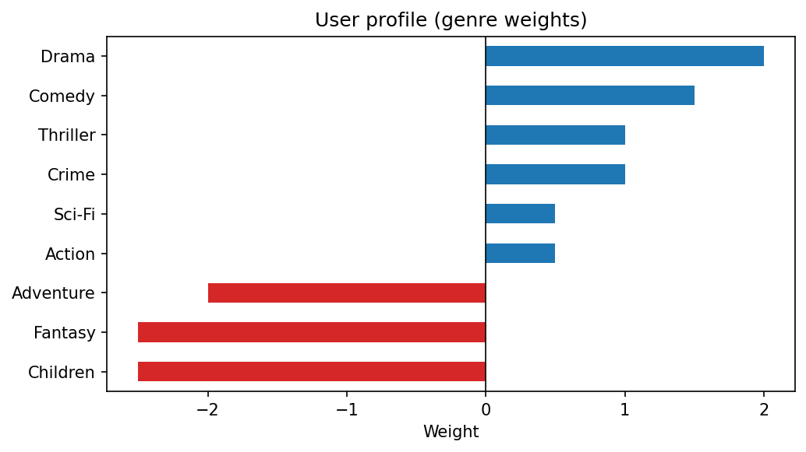

# 15 — Content-Based Recommender Systems

> Learning what a user likes about the movies they rated, and recommending more movies with those qualities.

**Notebook:** [`notebook.ipynb`](notebook.ipynb) — the full working, code, and plots.

---

## What this lesson covers

A recommender system answers *"what should this person see next?"* There are two
broad families. **Collaborative filtering** recommends what *similar users*
liked. **Content-based filtering**, the subject of this lesson, recommends items
*similar to what this user already liked*, using a description of each item —
here, a movie's genres.

The lesson builds a content-based recommender from scratch on the MovieLens
data: encoding genres as vectors, turning a user's ratings into a **user
profile**, weighting rare genres more heavily with **IDF**, and ranking 34,000
movies by **cosine similarity** to that profile.

---

## Intuition

Describe every movie by its genres — a row of 0s and 1s. A user rates a few
movies. Genres that appear in the movies they loved should count *for* a movie;
genres in movies they disliked should count *against* it. Add those up and you
have a profile of the user's taste in the same genre space as the movies. Then
recommend the movies that point in the same direction as the profile.

---

## The mathematics

**Movie vectors.** Movie $j$ is a binary vector $\mathbf{m}_j \in \{0, 1\}^{G}$
over $G = 19$ genres.

**User profile.** For the movies the user rated, subtract their mean rating so
that liked movies are positive and disliked ones negative, then sum the genre
vectors weighted by those centred ratings:

$$
\mathbf{p} = \sum_{j \in \text{rated}} (r_j - \bar{r})\, \mathbf{m}_j
$$

Without the centring, every rating is positive and a 2-star movie would still
*add* weight to its genres.

**IDF weighting.** A genre on thousands of movies (Drama) says less about taste
than a rare one (Film-Noir). Each genre $g$ gets the smoothed inverse document
frequency used by scikit-learn's `TfidfTransformer`:

$$
\text{idf}_g = \ln\frac{1 + N}{1 + \text{df}_g} + 1
$$

where $N$ is the number of movies and $\text{df}_g$ the number with genre $g$.
Both the movie vectors and the profile are multiplied by these weights.

**Scoring.** Each movie is scored by the cosine of the angle between its
weighted vector and the weighted profile:

$$
\text{score}_j = \frac{\mathbf{m}_j \cdot \mathbf{p}}{\lVert \mathbf{m}_j \rVert\, \lVert \mathbf{p} \rVert} \in [-1, 1]
$$

Unlike a plain weighted sum, cosine similarity does not favour movies simply for
listing many genres, and it handles negative profile weights naturally: a
negative score means the movie leans toward genres the user dislikes.

---

## The dataset

| Property | Value |
|---|---|
| **Source** | [MovieLens](https://grouplens.org/datasets/movielens/), GroupLens Research — supplied with the course |
| **Movies** | 34,208, each with a title, year and pipe-separated genres |
| **Ratings** | 3,899,999 ratings (0.5–5 stars) from 42,130 users, used here only to count each movie's popularity |
| **Genres** | 19, after dropping the `(no genres listed)` placeholder |

The ratings file is 102 MB, above GitHub's 100 MB file limit, so it is stored
gzip-compressed as `ratings_sample.csv.gz` (26 MB). The contents are identical,
and pandas reads the compressed file directly.

---

## What the code does

1. **Clean the movies** — extract the year from the title into its own column,
   then split the genres into lists.
2. **One-hot encode the genres** with `MultiLabelBinarizer`.
3. **Define a user** who rated five movies, and match the titles to movie ids
   case-insensitively, reporting any title that is not found.
4. **Build the user profile** from mean-centred ratings.
5. **Weight by IDF** and **score every movie** with cosine similarity.
6. **Rank** — remove the movies the user has already rated, and break ties by
   popularity.

---

## Results

The input user:

| Movie | Rating | Genres |
|---|---|---|
| The Breakfast Club | 5.0 | Comedy, Drama |
| Pulp Fiction | 5.0 | Comedy, Crime, Drama, Thriller |
| Akira | 4.5 | Action, Adventure, Animation, Sci-Fi |
| Toy Story | 3.5 | Adventure, Animation, Children, Comedy, Fantasy |
| Jumanji | 2.0 | Adventure, Children, Fantasy |

The profile reads sensibly: **Drama, Comedy, Crime and Thriller** pull toward a
movie, and **Children, Fantasy and Adventure** pull away — the genres of the two
lowest-rated movies. The IDF weights run from 1.77 for Drama, the most common
genre, to 6.16 for IMAX, the rarest.

The top recommendations are *Fargo*, *In Bruges*, *Confessions of a Dangerous
Mind*, *Freeway* and *Man Bites Dog* — dark crime comedy-dramas, close in spirit
to the Pulp Fiction and Breakfast Club the user loved.

### What the results reveal about the method

**The top of the list is one big tie.** Sixteen of the top twenty movies have
exactly the same score, 0.362, because they have exactly the same genres —
*Comedy, Crime, Drama, Thriller*, which is Pulp Fiction's genre set. Within that
tie the order is decided entirely by popularity: *Fargo* comes first because it
has 8,295 ratings. With only 19 genres to describe 34,000 movies, a great many
movies are identical as far as this system can tell. Genre alone cannot
separate a celebrated film from an obscure one with the same tags.

**A zero weight is ambiguous.** *Animation* gets a weight of exactly 0 — not
because the user is indifferent to animation, but because Toy Story (below their
average) and Akira (above it) cancel out. The profile cannot tell "mixed
feelings" from "never seen one".

**Five ratings make a thin profile.** Every weight comes from five movies, so a
single rating moves the profile substantially.

---

## Advantages and limits of content-based filtering

**Advantages**

- **Personal.** Built entirely from one user's ratings.
- **No item cold start.** A brand-new movie with no ratings can be recommended
  immediately, as long as its genres are known.
- **Explainable.** "Recommended because you like Crime and Thriller."

**Limits**

- **Coarse descriptions.** Genres give 19 dimensions, which is why so many
  movies tie. Real systems use richer content: tags, plot summaries as TF-IDF or
  sentence embeddings, cast and director.
- **No sense of quality.** Other users' opinions are ignored; popularity is used
  here only to break ties, not to score.
- **Little surprise.** Recommendations stay close to what the user already
  watched.
- **User cold start.** A new user with no ratings has no profile at all.

Most production systems are **hybrids**: content-based features to handle new
items, combined with collaborative filtering, which learns from the behaviour of
other users.

---

## Changes in this version

The notebook arrived already modernised from the course lab — vectorised
one-hot encoding, mean-centred ratings, IDF weighting, cosine similarity,
watched movies excluded, and its own table of changes from the original lab at
the end. For this repository it needed only:

- **Relative data paths** — `Path("data")` in place of a path that existed only
  on one machine.
- **The compressed ratings file**, to stay under GitHub's file size limit.
- **The user-profile chart exported** to `figures/` for this README.

---

## References

- Dataset: Harper, F. M. and Konstan, J. A. (2015). *The MovieLens Datasets:
  History and Context*. ACM Transactions on Interactive Intelligent Systems
  5(4), 19:1–19:19. Used under the MovieLens licence, as supplied with the course.
- Course: Machine Learning with Python (Jadi), based on the IBM / Cognitive Class
  content-based recommender lab.
- Lops, P., de Gemmis, M. and Semeraro, G. (2011). *Content-based Recommender
  Systems: State of the Art and Trends*. In *Recommender Systems Handbook*,
  Springer, 73–105.
- [scikit-learn: `MultiLabelBinarizer`](https://scikit-learn.org/stable/modules/generated/sklearn.preprocessing.MultiLabelBinarizer.html)
  and [TF-IDF](https://scikit-learn.org/stable/modules/feature_extraction.html#tfidf-term-weighting)
