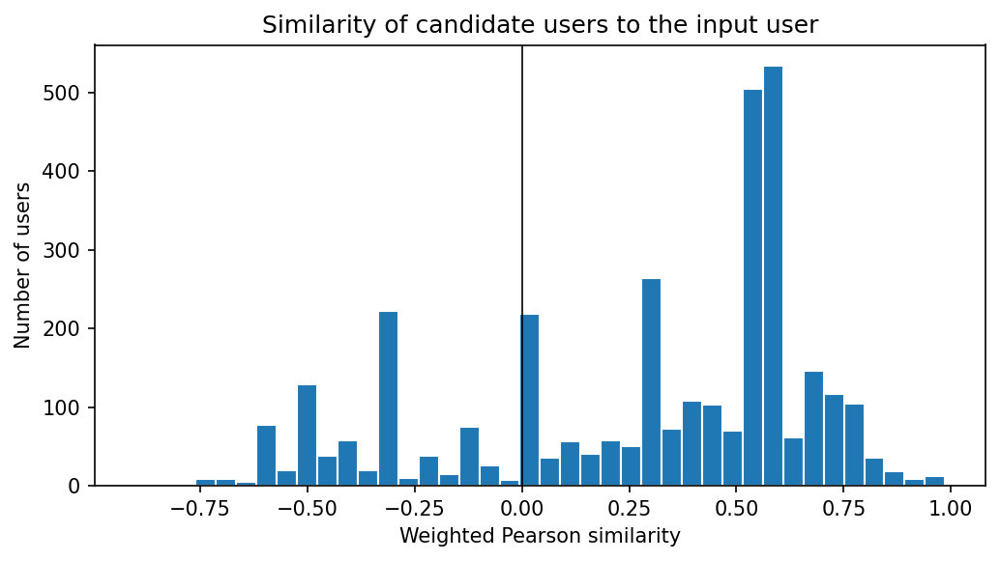

# 16 — Collaborative Filtering

> Recommending what people with similar taste enjoyed — without ever looking at what a movie is about.

**Notebook:** [`notebook.ipynb`](notebook.ipynb) — the full working, code, and plots.

---

## What this lesson covers

Lesson 15 recommended movies by their **content** — genres similar to the ones
a user liked. Collaborative filtering ignores content entirely. It looks only at
**who rated what, and how**, on the idea that people who agreed with you in the
past will agree with you again.

This lesson builds **user-user collaborative filtering** on the same MovieLens
data and the same input user as lesson 15, so the two approaches can be compared
directly. It covers finding users who rated the same movies, measuring taste
similarity with the **Pearson correlation**, weighting similarities by how much
evidence supports them, and predicting a score from the neighbours' mean-centred
ratings.

---

## Intuition

1. Find the users who rated the same movies as the input user.
2. Measure how closely each one's ratings track the input user's.
3. Keep the 50 most similar — the input user's **neighbours**.
4. For every movie the neighbours rated, ask: *did they like it more or less than
   they usually like things?* Weight each answer by how similar that neighbour
   is.
5. Recommend the movies the neighbours were most enthusiastic about.

---

## The mathematics

**Similarity.** For a user $v$ who shares $n$ movies with the input user $u$,
the Pearson correlation of their ratings on those movies:

$$
r_{uv} = \frac{\sum_{i=1}^{n}(x_i-\bar{x})(y_i-\bar{y})}{\sqrt{\sum_{i=1}^{n}(x_i-\bar{x})^2}\;\sqrt{\sum_{i=1}^{n}(y_i-\bar{y})^2}}
$$

Pearson ignores *how* a user uses the rating scale. One user who rates 3–5 and
another who rates 1–3 correlate perfectly if they rank the movies the same way.

**Significance weighting.** A correlation from 3 shared movies is far less
reliable than one from 5, so each similarity is scaled by the evidence behind it:

$$
\text{sim}(u, v) = r_{uv} \cdot \frac{\min(n, \gamma)}{\gamma}
$$

with $\gamma = 5$, the number of input movies.

**Prediction.** The score for movie $m$ starts from the input user's own average
rating and moves by the neighbours' similarity-weighted deviations from *their*
averages:

$$
\text{score}(m) = \bar{r}_u + \frac{\sum_{v} \text{sim}(u, v)\,\big(r_{v,m} - \bar{r}_v\big)}{\sum_{v} \lvert \text{sim}(u, v) \rvert}
$$

Using deviations rather than raw ratings means a 4 from a generous rater and a
4 from a harsh one are not treated as the same signal.

---

## The dataset

| Property | Value |
|---|---|
| **Source** | [MovieLens](https://grouplens.org/datasets/movielens/), GroupLens Research — the same files as lesson 15 |
| **Ratings** | 3,899,999 ratings (0.5–5 stars) from 42,130 users on 23,648 movies |
| **Movies** | 34,208 titles; genres are dropped, since collaborative filtering does not use them |

The ratings are stored gzip-compressed (26 MB instead of 102 MB, which is over
GitHub's file limit); pandas reads the compressed file directly.

---

## What the code does

| Step | Result |
|---|---|
| Users who rated at least one input movie | 19,795 |
| … who share **at least 3** of the 5 | 3,588 compared with the input |
| … whose correlation is defined | 3,384 (users who rated every shared movie the same have zero variance) |
| Neighbours kept | The 50 most similar, all with positive similarity |
| Movies scored | Every movie rated by at least 10 of the 50 neighbours, minus the ones already watched |

Three shared movies is the minimum because with only two, any two users always
correlate at exactly +1 or −1 — two points always lie on a straight line.

---

## Results

The input user is the same as in lesson 15: *The Breakfast Club* (5),
*Pulp Fiction* (5), *Akira* (4.5), *Toy Story* (3.5) and *Jumanji* (2).

**The spikes in the histogram are a warning, not a pattern.** Users who share
only three movies with the input can produce just a handful of correlation
values — 279 users correlate at exactly +1 or −1 — and significance weighting
multiplies them by 3/5. The tall bars at about ±0.6 and ±0.3 are those users:
artefacts of too little data, not clusters of taste. This is exactly why the
weighting exists. All 50 neighbours finally chosen share all five movies with
the input.

### The recommendations

| # | Movie | Year | Score | Neighbours who rated it |
|---|---|---|---|---|
| 1 | The Dark Knight | 2008 | 5.30 | 20 |
| 2 | Seven Samurai | 1954 | 5.27 | 23 |
| 3 | Yojimbo | 1961 | 5.23 | 10 |
| 4 | Fight Club | 1999 | 5.20 | 47 |
| 5 | The Big Lebowski | 1998 | 5.17 | 38 |
| 6 | American Beauty | 1999 | 5.14 | 42 |
| 7 | Dead Alive (Braindead) | 1992 | 5.12 | 10 |
| 8 | Memento | 2000 | 5.10 | 43 |
| 9 | North by Northwest | 1959 | 5.09 | 18 |
| 10 | The Good, the Bad and the Ugly | 1966 | 5.09 | 25 |

Scores are on the rating scale, centred on the input user's average of 4.0. A
score above 5 is possible and only means the neighbours were unusually
enthusiastic; it is a ranking, not a predicted star rating.

### Compared with lesson 15

For the same user, **the two top lists share no movies**: none of this lesson's
top 10 appears in lesson 15's top 20.

| Content-based (lesson 15) | Collaborative (this lesson) |
|---|---|
| *Fargo*, *In Bruges*, *Confessions of a Dangerous Mind*, *Freeway*… | *The Dark Knight*, *Seven Samurai*, *Yojimbo*, *Fight Club*… |
| Every top pick is a Comedy–Crime–Drama–Thriller, the genre set of *Pulp Fiction* | Samurai epics, a western, a Hitchcock thriller, a splatter comedy |
| 16 of the top 20 tie on score; popularity decides | Every movie gets its own score |
| Knows nothing about quality | Recommends widely acclaimed films |

Content-based filtering found *more of the same kind*. Collaborative filtering
found *what people like this user loved* — including films from genres the user
never rated, which no genre profile could have produced. That is its main
strength, and the reason most real systems combine both.

---

## Advantages and limits of collaborative filtering

**Advantages**

- **Uses the crowd's judgement** — quality is built in, because acclaimed movies
  are rated highly by many neighbours.
- **Needs no item description** — no genres, tags or plots.
- **Can surprise** — it reaches beyond the genres the user already watches.

**Limits**

- **Cold start** — a new user with no ratings has no neighbours; a new movie
  nobody has rated can never be recommended. Content-based filtering has neither
  problem for new items.
- **Sparsity** — 3.9 million ratings sound like many, but most users have rated
  a tiny fraction of the 34,000 movies, so overlaps are small. Of the 19,795
  users who rated any of the five input movies, only 244 rated all five.
- **Scale** — comparing one user with every other user is slow for millions of
  users.
- **Popularity bias** — well-known movies have more raters, so they reach the
  minimum-support threshold more easily than niche ones.

Large production systems use **model-based** collaborative filtering instead —
matrix factorisation (SVD, ALS) or neural recommenders — which learn a compact
"taste vector" for every user and movie from the whole rating matrix at once,
and handle sparsity and scale far better than comparing users directly.

---

## Changes in this version

The notebook arrived already modernised. For this repository:

- **Relative data paths** — `Path("data")` replacing a path that existed only on
  one machine, and the compressed ratings file.
- **A stable sort** for ranking users by shared movies. 244 users tie at five
  shared movies, and an unstable sort listed different users on different runs;
  `kind='stable'` keeps tied users in id order. This changed only a displayed
  table, not any score.
- **The similarity histogram exported** to `figures/` for this README.

---

## References

- Dataset: Harper, F. M. and Konstan, J. A. (2015). *The MovieLens Datasets:
  History and Context*. ACM Transactions on Interactive Intelligent Systems
  5(4), 19:1–19:19. Used under the MovieLens licence, as supplied with the course.
- Course: Machine Learning with Python (Jadi), based on the IBM / Cognitive Class
  collaborative filtering lab.
- Herlocker, J. L., Konstan, J. A., Borchers, A. and Riedl, J. (1999). *An
  Algorithmic Framework for Performing Collaborative Filtering*. SIGIR '99,
  230–237 — the source of significance weighting.
- Koren, Y., Bell, R. and Volinsky, C. (2009). *Matrix Factorization Techniques
  for Recommender Systems*. IEEE Computer 42(8), 30–37.
- Builds on [lesson 15 — Content-Based Recommender Systems](../15-content-based-recommender/).
