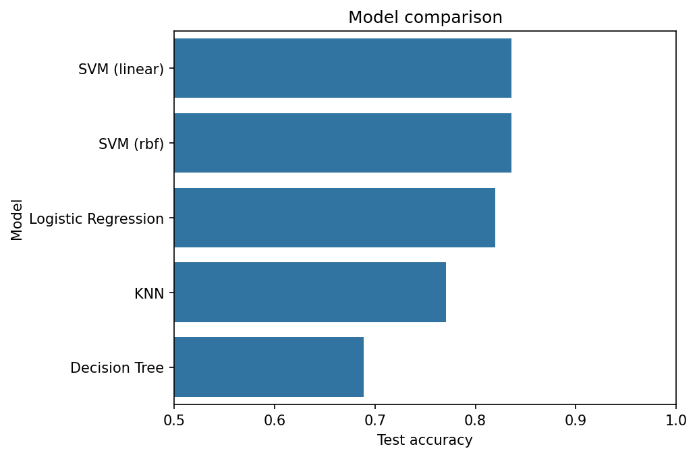

# Heart Attack Prediction

> Classifying patients into two risk groups from thirteen clinical measurements — an end-to-end classification project comparing four model families.

**Notebook:** [`notebook.ipynb`](notebook.ipynb) — cleaning, EDA, preprocessing, five models, and the comparison.

---

## What this project is

The Tehran project carried a regression problem from raw data to a working
predictor. This one does the same for **classification**: the patient records go
through cleaning, exploration and preprocessing, then KNN, logistic regression, a
decision tree and two support vector machines are each tuned by cross-validation
and scored on the same held-out patients.

The headline result: **83.6% test accuracy** from both SVMs, against a 54.1%
baseline. A second finding matters as much, though: on a dataset this small, four
of the five models cannot honestly be separated.

---

## The dataset

| Property | Value |
|---|---|
| **Rows** | 303 patients (302 after removing one duplicate) |
| **Features** | 13 — 5 numeric (`age`, `trtbps`, `chol`, `thalachh`, `oldpeak`), 8 categorical (`sex`, `cp`, `fbs`, `restecg`, `exng`, `slp`, `caa`, `thall`) |
| **Target** | `output` — two classes, 164 vs 138 patients |
| **Split** | 80 / 20, stratified, `random_state=42` — 241 training, 61 test |

| Column | Meaning |
|---|---|
| `trtbps` | Resting blood pressure |
| `chol` | Serum cholesterol |
| `thalachh` | Maximum heart rate reached |
| `exng` | Angina brought on by exercise |
| `oldpeak` | ST depression during exercise, relative to rest |
| `cp` | Chest pain type |
| `caa` | Number of major vessels coloured by fluoroscopy |
| `thall` | Thallium stress test result |

### Cleaning

| Problem | Action | Why it matters |
|---|---|---|
| 1 duplicate row | Dropped | A duplicate can land in both train and test and be scored on a row the model memorised |
| `caa = 4` in 5 rows (valid range is 0–3) | Replaced with the column's mode | Too few rows to justify dropping, and the value is impossible as recorded |
| `thall = 0` in 2 rows (valid range is 1–3) | Replaced with the column's mode | Same reasoning |

No values were missing.

---

## What the code does

**EDA** compares each feature across the two classes. Chest pain type, maximum
heart rate, exercise angina, ST depression, vessel count and the thallium result
separate the classes clearly. Fasting blood sugar barely differs between them.

**Preprocessing** follows the order that keeps the test set honest:

1. **Label-encode** the categorical columns so each runs 0, 1, 2, … without gaps.
2. **Split** 80/20, stratified so both halves keep the 54/46 class ratio.
3. **Scale** with `StandardScaler` fitted on the training set alone, then applied
   to both. KNN and SVM measure distances, and unscaled, `chol` (around 250)
   would swamp `oldpeak` (around 1).

**Tuning** never touches the test set. KNN's `k` (1–30) and the tree's
`max_depth` (1–10) are each chosen by 5-fold cross-validation on the training
data, and the SVM kernel is compared the same way.

---

## Results

| Model | Chosen setting | CV accuracy (train) | Test accuracy |
|---|---|---|---|
| Always predict the larger class | — | — | 0.541 |
| Decision tree | `max_depth = 1` | 0.776 | 0.689 |
| KNN | `k = 4` | 0.835 | 0.770 |
| Logistic regression | — | 0.838 | 0.820 |
| **SVM, linear kernel** | — | 0.830 | **0.836** |
| **SVM, RBF kernel** | — | 0.822 | **0.836** |



**Every model clears the baseline comfortably.** That said, how far the models
differ *from each other* is mostly decided by the 61-patient test set:

- One patient is worth **1.6 percentage points** of test accuracy. The two SVMs
  and logistic regression are separated by a single patient.
- **Cross-validation tells a different story from the test set.** On the training
  folds, KNN (0.835), logistic regression (0.838) and both SVMs (0.822–0.830) are
  effectively tied. KNN then drops 6.5 points on the test set — not because it is
  a worse method here, but because 61 patients is a noisy measuring stick.

The conclusion the data actually supports is that **KNN, logistic regression and
both SVMs perform about equally well, and the single tree is clearly weaker.**

**The decision tree** is the one result that is not noise. Cross-validation
preferred `max_depth = 1` — a single question, *is chest pain type 0?* — and CV
accuracy stayed between 0.731 and 0.776 at every depth up to 10. Deeper trees
found no rule that generalised; they only fitted the 241 training patients more
closely. A single tree is too blunt for this problem, and the random forest in
[lesson 09](../../lessons/09-random-forest/) exists to fix exactly that.

**Linear models are enough.** The linear SVM matches the curved RBF boundary, and
logistic regression is within one patient. The two classes are separated about as
well by a flat boundary as by a flexible one.

### The errors, in patients

| Model | Class-1 patients missed (of 33) | Class-0 patients misclassified (of 28) |
|---|---|---|
| SVM, linear | 1 | 9 |
| SVM, RBF | 2 | 8 |
| Logistic regression | 4 | 7 |
| KNN | 9 | 5 |
| Decision tree | 10 | 9 |

The two SVMs score identically but trade errors differently from logistic
regression. Both SVMs lean heavily toward predicting class 1: they almost never
miss a class-1 patient and misclassify about a third of class 0. Which trade is
better depends entirely on which class is the dangerous one to miss — see the
caution below.

### Which features drive the prediction

Logistic regression coefficients on the scaled features (positive pushes toward
class 1):

| Feature | Coefficient | | Feature | Coefficient |
|---|---|---|---|---|
| `cp` | +0.92 | | `caa` | −0.81 |
| `thalachh` | +0.58 | | `sex` | −0.75 |
| `slp` | +0.31 | | `thall` | −0.56 |
| `restecg` | +0.23 | | `oldpeak` | −0.55 |
| `age` | +0.13 | | `exng` | −0.47 |
| `fbs` | +0.01 | | `chol` | −0.44 |

`fbs` contributes essentially nothing, as the EDA suggested. `chol` is less
simple: its correlation with the target alone is only −0.08, yet the model gives
it a weight similar to `exng` once the other features are held fixed. A feature
can look useless on its own and still carry information in combination.

---

## A caution about the label

The target is described as the chance of a heart attack, with **1 = high**. The
features suggest the opposite. Every well-established cardiac risk factor in the
data points toward **class 0**:

- exercise-induced angina (`exng = 1`) → mostly class 0
- greater ST depression (`oldpeak`) → class 0
- more vessels with visible narrowing (`caa`) → class 0
- being male and being older → class 0
- a higher maximum heart rate — a sign of good cardiac fitness → class 1

The class sizes point the same way. This data derives from the UCI Cleveland
heart-disease study, which has 164 patients without disease and 139 with it. The
raw file here has 165 in class 1 and 138 in class 0 — close to that split, with
class 1 in the place of the patients *without* disease.

This does not change any accuracy above, since accuracy treats both classes
symmetrically. It does change which error matters. If class 0 is in fact the
diseased group, the costly mistake is predicting 1 for a class-0 patient, and
that is where the SVMs do worst (9 of 28). Logistic regression (7 of 28) and KNN
(5 of 28) would be the safer choices.

**This is a teaching dataset, not a diagnostic tool**, and nothing here should
inform a real medical decision.

---

## Possible improvements

- **Report cross-validated accuracy as the headline**, with its spread across
  folds, rather than a single 61-patient test score.
- **Tune the decision threshold** toward recall on the dangerous class, once the
  label question above is settled.
- **One-hot encode the nominal categories** (`cp`, `restecg`, `slp`, `thall`).
  Label encoding implies an order: chest pain type 3 is "three times" type 1. On
  this split, one-hot encoding did not improve the linear models.
- **Ensembles** — the random forest and gradient boosting from lessons 09 and 10
  are the natural answer to the single tree's weakness.

---

## Reproducing

```bash
pip install -r ../../requirements.txt
jupyter notebook notebook.ipynb
```

Every number above comes from a clean top-to-bottom run with `random_state=42`.

---

## References

- Dataset: `heart.csv`, as supplied with the course. Its column naming matches the
  Kaggle *Heart Attack Analysis & Prediction* dataset, which is derived from the
  [UCI Heart Disease](https://archive.ics.uci.edu/dataset/45/heart+disease)
  Cleveland data (Detrano et al., 1989).
- Course: Machine Learning with Python (Jadi).
- [scikit-learn: Support Vector Machines](https://scikit-learn.org/stable/modules/svm.html)
- [scikit-learn: Cross-validation](https://scikit-learn.org/stable/modules/cross_validation.html)
