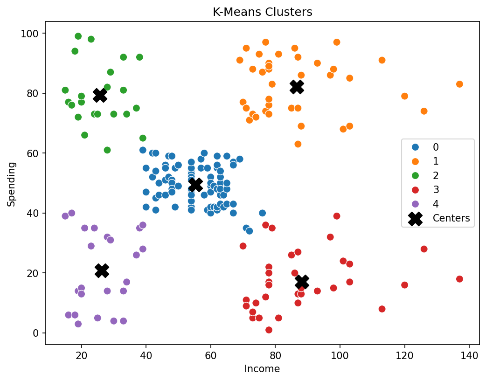

# Mall Customer Segmentation

> Dividing 200 shoppers into groups with three clustering algorithms — and turning each group into a marketing strategy.

**Notebook:** [`notebook.ipynb`](notebook.ipynb) — cleaning, EDA, three models, comparison and cluster profiles.

---

## What this project is

Lessons 12–14 each introduced one clustering method on its own dataset. This
project puts all three — **k-means, hierarchical clustering and DBSCAN** — to
work on the same problem and compares them: a mall wants to understand its
customers well enough to treat different groups differently, and has no labels
to say what those groups are.

The headline result: **five clear customer segments**, found independently by
k-means, by hierarchical clustering and by the dendrogram, with a silhouette
score of 0.55 — each segment distinct enough to suggest its own marketing
approach.

---

## The dataset

| Property | Value |
|---|---|
| **Source** | `Mall_Customers.csv` — a widely used teaching dataset of mall membership records |
| **Rows** | 200 customers |
| **Columns** | `CustomerID`, `Gender`, `Age`, `Annual Income (k$)`, `Spending Score (1-100)` |
| **Spending score** | Assigned by the mall from customer behaviour and purchasing data |
| **Missing values / duplicates** | None |

### Preparation

| Step | Decision | Why |
|---|---|---|
| Rename columns | `Income`, `Spending` | The originals were long and contained spaces |
| Outliers | Two incomes of 137 k$ **kept** | They are real high earners, not data errors |
| Gender | Encoded 0 / 1, then **not used** | Men and women were spread evenly through every group in the pairplot |
| Features | `Income` and `Spending` only | They showed the clearest group structure, and two features let every result be drawn and checked by eye |
| Scaling | `StandardScaler` | All three algorithms use distances |

---

## What the code does

**EDA.** Distributions, a pairplot and correlations. The Income-against-Spending
panel shows about five visible groups; Income and Spending are almost
uncorrelated, so they carry independent information.

**K-means.** `k` from 2 to 10, chosen by two criteria together:

| k | 2 | 3 | 4 | **5** | 6 | 7 | 8 |
|---|---|---|---|---|---|---|---|
| Inertia (WCSS) | 269.7 | 157.7 | 108.9 | **65.6** | 55.1 | 44.9 | 37.2 |
| Silhouette | 0.321 | 0.467 | 0.494 | **0.555** | 0.540 | 0.528 | 0.455 |

The elbow and the silhouette peak agree on **k = 5**.

**Hierarchical clustering.** A Ward-linkage dendrogram, cut where its vertical
gaps are longest, also gives five clusters. Four linkages were compared:

| Linkage | Silhouette |
|---|---|
| Ward | 0.554 |
| Complete | 0.553 |
| Average | 0.479 |
| Single | 0.276 |

Single linkage fails exactly as lesson 13 predicted: it chains from point to
point and puts 195 of the 200 customers into one cluster.

**DBSCAN.** `eps` from a k-distance plot (0.35, with `min_samples` = 5).

---

## Results



| Model | Clusters | Silhouette |
|---|---|---|
| **K-means** | 5 | **0.555** |
| Hierarchical (Ward) | 5 | 0.554 |
| DBSCAN | 6 + 23 noise | 0.558 *(noise excluded)* |

**K-means and hierarchical clustering agree almost completely** — they put 196 of
the 200 customers in the same groups. Two methods built on different ideas
finding the same structure is strong evidence that the five segments are real.

**DBSCAN's higher score is not a fair comparison.** It is computed without the
23 customers it labelled noise — mostly high earners at the edges of their
groups — so it scores only the easy points. DBSCAN also splits the
low-income, low-spending group into two small clusters, because that group is
sparser than the dense middle one: the single-$\varepsilon$ limitation from
lesson 14. Its noise labels are still useful, though, as a list of unusual
customers worth a closer look.

**K-means is the final model**: as good as hierarchical clustering, every
customer gets a segment, and the result is easy to explain.

### The five segments

| Segment | Customers | Age | Income (k$) | Spending | Description | Suggested approach |
|---|---|---|---|---|---|---|
| 0 | 81 | 42.7 | 55.3 | 49.5 | Average income, average spending | General offers and campaigns |
| 1 | 39 | 32.7 | 86.5 | 82.1 | High income, high spending | The most valuable group — loyalty programmes and premium services |
| 2 | 22 | 25.3 | 25.7 | 79.4 | Low income, high spending, young | Discounts and new, trend-led products |
| 3 | 35 | 41.1 | 88.2 | 17.1 | High income, low spending | Able to spend more — worth finding out what would bring them in |
| 4 | 23 | 45.2 | 26.3 | 20.9 | Low income, low spending | Value products and discount days |

Age was not used to build the clusters, yet it separates them: the two
high-spending groups are the youngest (25 and 33 on average), and the two
low-spending groups the oldest (41 and 45). Like price in lesson 13, a feature
the algorithm never saw lining up with its clusters suggests the segments
reflect something real about the customers.

---

## Limits

- **Two features.** Clustering on income and spending alone makes the groups
  easy to see and explain, but ignores anything else that might distinguish
  customers.
- **A small, tidy dataset.** 200 customers with no missing values and very
  clear structure — real customer data is rarely this clean, and the segments
  would need checking against new data before being acted on.
- **The spending score is the mall's own measure**, and how it is calculated is
  not documented in the data.

---

## Reproducing

```bash
pip install -r ../../requirements.txt
jupyter notebook notebook.ipynb
```

Every number above comes from a clean top-to-bottom run with `random_state=42`.

---

## References

- Dataset: `Mall_Customers.csv`, a common customer-segmentation teaching
  dataset, as used in the course.
- Course: Machine Learning with Python (Jadi).
- Rousseeuw, P. J. (1987). *Silhouettes: a Graphical Aid to the Interpretation
  and Validation of Cluster Analysis*. Journal of Computational and Applied
  Mathematics 20, 53–65.
- [scikit-learn: Clustering](https://scikit-learn.org/stable/modules/clustering.html)
- Builds on lessons [12 — K-Means](../../lessons/12-k-means-clustering/),
  [13 — Hierarchical Clustering](../../lessons/13-hierarchical-clustering/) and
  [14 — DBSCAN](../../lessons/14-dbscan/).
