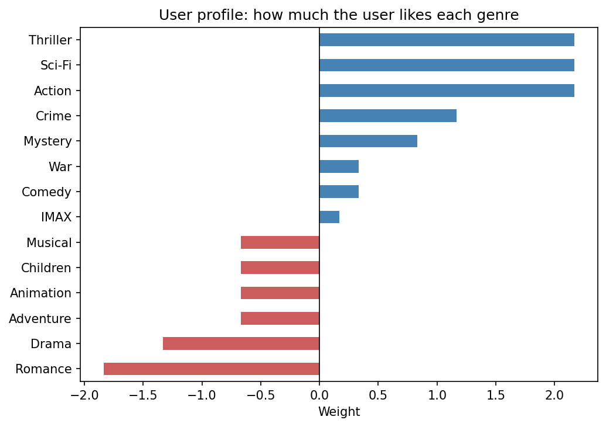

# Movie Recommender System

> Two recommenders — one that reads a movie's genres, one that learns from other viewers — built on 3.9 million ratings and compared side by side for the same user.

**Notebook:** [`notebook.ipynb`](notebook.ipynb) — exploration, both recommenders, and the comparison.

---

## What this project is

Lessons 15 and 16 each built one kind of recommender. This project builds both
end to end on the same data and the same user, explores the data first, and
compares the two lists:

1. **Content-based filtering** — learns which genres the user likes and recommends
   movies with those genres.
2. **User-user collaborative filtering** — finds viewers whose ratings track the
   user's and recommends what they enjoyed.

The headline result: for a user who loves *The Matrix* and dislikes
*The Notebook*, the two systems recommend **no movies in common**. One returns
ten Action–Sci-Fi–Thrillers; the other returns *Fight Club*, *Léon*,
*Amélie*, *The Shawshank Redemption* and *Rear Window*.

---

## The dataset

| Property | Value |
|---|---|
| **Source** | [MovieLens](https://grouplens.org/datasets/movielens/), GroupLens Research, University of Minnesota |
| **Movies** | 34,208 titles with year and genres |
| **Ratings** | 3,899,999 ratings, 0.5–5 stars, from 42,130 users on 23,648 movies |
| **Missing values / duplicates** | None |

**The data is not stored again here.** These are exactly the same two files as
lessons 15 and 16, so the notebook reads them from
[`lessons/15-content-based-recommender/data/`](../../lessons/15-content-based-recommender/data/)
instead of keeping another 28 MB copy — the files exist only once in the repository. Run the notebook from this folder and the
relative path resolves on its own.

### What exploration showed

- **Ratings lean positive.** Most are 3 or above, and whole stars are far more
  common than half stars — people mostly rate what they chose to watch.
- **Drama and Comedy dominate** the genres; Film-Noir and IMAX are rare.
- **Activity is extremely uneven.** The median user rated 29 movies, the most
  active rated 5,691. Each user has seen a tiny fraction of the 34,000 movies,
  so the user–movie matrix is almost entirely empty — the reason recommenders
  exist.
- **A raw average needs a minimum count.** A movie with one 5-star rating has a
  perfect average, so "best rated" lists here only consider the top 10% of
  movies by number of ratings (at least 310). On that list *The Shawshank
  Redemption* leads with 4.44 from 13,234 ratings.

---

## The input user

| Movie | Rating |
|---|---|
| The Matrix | 5.0 |
| Inception | 4.5 |
| The Godfather | 4.0 |
| Forrest Gump | 4.0 |
| The Lion King | 3.0 |
| The Notebook | 1.5 |

---

## Part 1 — content-based

Ratings are centred on the user's average (3.67), then summed per genre into a
**user profile**, and every movie is scored by **cosine similarity** between its
genre vector and the profile. Watched movies are removed, and only movies in
the top 10% by number of ratings are recommended.



Action, Sci-Fi and Thriller lead, from *The Matrix* and *Inception*. Romance is
the most disliked genre, from *The Notebook*.

**One dislike can outweigh three likes.** Drama comes out as the user's
*second* most disliked genre, although they rated *The Godfather* and
*Forrest Gump* — both dramas — a solid 4. Those ratings are only slightly above
the user's average (+0.33 each), while *The Notebook*, also a drama, sits far
below it (−2.17). With only six movies, a single strong rating decides a whole
genre.

| # | Movie | Genres | Score |
|---|---|---|---|
| 1 | RoboCop 2 | Action, Crime, Sci-Fi, Thriller | 0.794 |
| 2 | Minority Report | Action, Crime, Mystery, Sci-Fi, Thriller | 0.787 |
| 3 | The X-Files: Fight the Future | Action, Crime, Mystery, Sci-Fi, Thriller | 0.787 |
| 4–10 | The Terminator, Blade Runner, Predator, Johnny Mnemonic, Godzilla, Equilibrium, X-Men: The Last Stand | Action, Sci-Fi, Thriller | 0.777 |

**Seven of the ten tie exactly**, because they have exactly the same genres.
Within the tie, order is decided by number of ratings — so *The Terminator* and
*Godzilla* are ranked as equally good matches. Genre cannot tell them apart.

---

## Part 2 — collaborative filtering

| Step | Result |
|---|---|
| Users who rated at least one input movie | 21,525 |
| … who rated **at least 4** of the 6 (to make the correlation meaningful) | 2,965 |
| Neighbours | The 50 most similar by Pearson correlation, all positive |
| Score | Similarity-weighted average of the neighbours' ratings |
| Minimum support | A movie needs at least 10 neighbours who rated it |

| # | Movie | Score | Neighbours |
|---|---|---|---|
| 1 | Fight Club | 4.43 | 44 |
| 2 | Léon: The Professional | 4.39 | 27 |
| 3 | Pulp Fiction | 4.35 | 46 |
| 4 | Amélie | 4.33 | 26 |
| 5 | La Femme Nikita | 4.30 | 10 |
| 6 | Memento | 4.28 | 37 |
| 7 | The Shawshank Redemption | 4.27 | 41 |
| 8 | The Lord of the Rings: The Two Towers | 4.26 | 39 |
| 9 | Rear Window | 4.25 | 12 |
| 10 | Dr. Strangelove | 4.24 | 21 |

The scores read like predicted star ratings. The list reaches well beyond
Action and Sci-Fi — a romantic comedy, fantasy, a Hitchcock thriller, a war
satire — into genres a genre profile built from these six movies could not
reach.

**The most "similar" neighbours have the least evidence.** Fifteen users
correlate with the input at exactly 1.0, and every one of them shares only four
movies with it — the minimum allowed. A perfect correlation on four ratings is
easy to reach by chance. Lesson 16 handles this with *significance weighting*,
which scales each similarity by how many movies support it; adding it here
would favour neighbours who agree on all six movies.

---

## Comparison

| | Content-based | Collaborative |
|---|---|---|
| Top picks | RoboCop 2, Minority Report, The Terminator… | Fight Club, Léon, Pulp Fiction, Amélie… |
| Variety | Ten Action–Sci-Fi–Thrillers | A wide spread of genres |
| Knows quality? | No — *Godzilla* scores the same as *The Terminator* | Yes — neighbours rate the acclaimed films highly |
| Ties | Seven of ten identical scores | Every movie scored separately |
| New movie, no ratings | Can recommend it immediately | Cannot recommend it |

**Movies recommended by both: none.** The two answer different questions —
*"which movies look like the ones you liked?"* and *"what did people like you
enjoy?"* — which is why production systems commonly combine them in a
**hybrid** recommender.

---

## Changes for this repository

- **Named for its real data.** The notebook was titled an IMDB recommender, but
  the movies and ratings come from MovieLens, not IMDb. The title and text now
  say so.
- **Data read from lesson 15** instead of a local copy, as described above.
- **Stable sorting** where values tie (fifteen users at similarity 1.0, and
  genres with equal profile weights), so the displayed tables are identical on
  every run. No recommendation changed.
- **The profile chart exported** to `figures/` for this README.

---

## Reproducing

```bash
pip install -r ../../requirements.txt
jupyter notebook notebook.ipynb
```

Run it from this folder, so the path to lesson 15's data resolves.

---

## References

- Dataset: Harper, F. M. and Konstan, J. A. (2015). *The MovieLens Datasets:
  History and Context*. ACM Transactions on Interactive Intelligent Systems
  5(4), 19:1–19:19. Used under the MovieLens licence, as supplied with the course.
- Course: Machine Learning with Python (Jadi).
- Builds on lessons [15 — Content-Based Recommender Systems](../../lessons/15-content-based-recommender/)
  and [16 — Collaborative Filtering](../../lessons/16-collaborative-filtering/).
