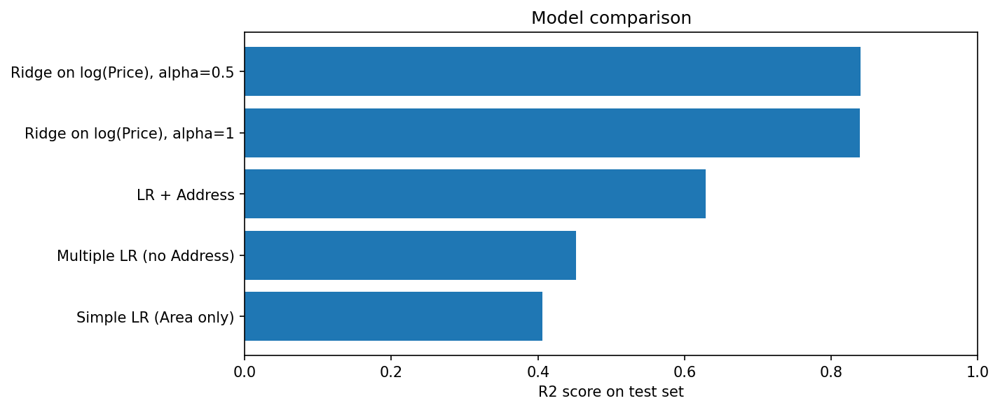

# Tehran House Price Prediction

> Predicting apartment prices in Tehran from area, rooms, amenities and neighbourhood — an end-to-end regression project.

**Notebook:** [`notebook.ipynb`](notebook.ipynb) — cleaning, EDA, four models, and the final predictor.

---

## What this project is

The lessons in [`lessons/`](../../lessons/) each isolate one technique. This
project puts them together on a messy real dataset and carries the work through
every stage: cleaning, exploration, feature engineering, four models compared on
held-out data, hyperparameter tuning by cross-validation, and a function that
prices a house it has never seen.

The headline result: R² improves from **0.41 to 0.84** on the test set, and the
average error roughly halves — from 2.74 to 1.25 billion Toman.

---

## The dataset

| Property | Value |
|---|---|
| **Rows** | 3,479 Tehran apartment listings |
| **Features** | `Area` (m²), `Room`, `Parking`, `Warehouse`, `Elevator`, `Address` (192 neighbourhoods) |
| **Target** | `Price`, in Toman |
| **Excluded** | `Price(USD)` — see *Data leakage* below |
| **Split** | 80 / 20, `random_state=42` — 2,594 training rows, 649 test rows |

### Cleaning

The raw file needed four fixes before it could be modelled at all:

| Problem | Action | Why it matters |
|---|---|---|
| `Area` stored as text with commas (`"1,000"`) | Stripped commas, converted to numeric | Models need numbers, and pandas had typed the column as a string |
| Some areas were in the billions (16,160,000,000 m²) | Dropped rows above 1,000 m² | Someone had typed the price into the area column; a single value like that drags the whole regression line toward it |
| 23 listings had no address | Dropped them | Location turns out to be the strongest predictor, so these rows cannot contribute |
| 208 duplicate rows | Dropped them | A duplicate can land in both train and test, letting the model be scored on a row it memorised |

3,479 rows in, 3,243 out.

### Data leakage

`Price(USD)` is just `Price` divided by the exchange rate. Using it as a feature
would hand the model the answer — a perfect score that means nothing. It is
dropped before any model sees it.

The same trap appears a second time during EDA: `price_per_m2` is computed to
rank neighbourhoods by cost, then explicitly dropped before feature preparation,
because it is derived from the target.

---

## What the code does

**EDA** turned up the two facts that shaped every modelling decision:

- **Price is heavily right-skewed** — most apartments are ordinary, a few are
  enormous. Plotted beside `log(Price)`, the log version is close to normal.
- **Location dominates.** Average price per m² runs from about 4.2 million Toman
  in Malard to 140 million in Gandhi — a factor of more than 30.

**Feature preparation** one-hot encodes `Address` with `drop_first=True`,
producing 186 columns. Encoding a neighbourhood as 1, 2, 3… would tell the model
that Vanak is "twice" Punak, which is meaningless; one-hot imposes no false
ordering.

The encoding is built from the **training** addresses only, and the test set is
reindexed onto those same columns. This matters more than it looks: ten
neighbourhoods appear only in the test data, and encoding before the split would
create columns with no training rows behind them. The training matrix becomes
rank deficient, plain OLS assigns those columns arbitrary coefficients, and a
single test house in one of them can push R² to −2.5 × 10¹⁷. Fitting the encoder
on the training set alone keeps the matrix full rank.

**Models** are built in four steps, each adding a single idea, each scored on the
same held-out test set.

---

## Results

| # | Model | Test R² | MAE (billion Toman) | RMSE (billion Toman) |
|---|---|---|---|---|
| 1 | Simple LR — `Area` only | 0.406 | 2.742 | 6.051 |
| 2 | Multiple LR — + rooms, parking, warehouse, elevator | 0.452 | 2.973 | 5.812 |
| 3 | Multiple LR — + `Address` (one-hot) | 0.628 | 2.153 | 4.785 |
| 4 | **Ridge on `log(Price)`, α = 0.5** | **0.840** | **1.253** | **3.137** |



**Step 1 → 2.** Adding rooms, parking, warehouse and elevator moves R² by only
0.046, and MAE actually gets *worse*. These amenities carry little information
once area is known — they mostly travel with it.

**Step 2 → 3.** Adding the neighbourhood is the single largest jump: +0.176.
This is exactly what EDA predicted, and it is the main thing the earlier lessons
missed — a model can only be as good as the information it is given.

**Step 3 → 4.** The largest improvement of all, +0.212, from two changes:

- **Predicting `log(Price)` instead of `Price`.** A linear model adds effects
  together: so many Toman per m², so many for being in Vanak. Real prices do not
  work that way — location *multiplies*. An extra m² in Vanak is worth far more
  than an extra m² in Parand. Since `log(a × b) = log(a) + log(b)`, modelling the
  log lets an additive model express a multiplicative reality. It also compresses
  the long right tail so a handful of mansions stop dominating the fit.
  Predictions are converted back with `exp()`.
- **Ridge instead of plain linear regression.** With 186 columns and many
  neighbourhoods represented by only two or three houses, unpenalised regression
  will happily conclude that a neighbourhood is extraordinarily expensive on the
  evidence of one lucky listing. Ridge penalises large coefficients and keeps
  those conclusions modest.

**Choosing α.** Ridge's penalty strength is a hyperparameter — chosen by hand,
not learned. It was selected by 5-fold cross-validation *on the training set*:
split the training data into five parts, train on four and score on the fifth,
five times, then average. α = 0.5 scored best (mean CV R² 0.8779 on the log
scale). The test set stayed untouched until the final evaluation.

**Where the model still fails.** RMSE (3.137) is far larger than MAE (1.253).
Since RMSE punishes large errors much more heavily, that gap says the model is
usually close but occasionally very wrong — and the real-vs-predicted plot shows
those misses concentrated among the most expensive properties in north Tehran.
Luxury pricing depends on things this dataset does not record.

---

## Using the model

`predict_price(area, room, parking, warehouse, elevator, address)` prices a new
apartment. A 100 m² flat in Punak with 2 rooms, parking, warehouse and elevator
comes out at about 4.38 billion Toman.

One caveat worth knowing: if the address is not one the model was trained on, the
function silently falls back to the reference neighbourhood rather than reporting
that it cannot answer. The number it returns will look reasonable and be
untrustworthy.

---

## Possible improvements

- Features the dataset does not have: building age, floor number, renovation
  status — likely where much of the remaining error lives.
- Non-linear models (random forest, gradient boosting) can capture interactions a
  linear model cannot.
- `exp()` of a prediction made on the log scale estimates the median rather than
  the mean, which biases prices slightly low; a smearing correction would address
  it.

---

## Reproducing

```bash
pip install -r ../../requirements.txt
jupyter notebook notebook.ipynb
```

Every number above comes from a clean top-to-bottom run with `random_state=42`.

---

## References

- Dataset: Tehran house prices (`housePrice.csv`), as supplied with the course.
- Course: Machine Learning with Python (Jadi).
- [scikit-learn: Ridge regression](https://scikit-learn.org/stable/modules/linear_model.html#ridge-regression-and-classification)
- [scikit-learn: Cross-validation](https://scikit-learn.org/stable/modules/cross_validation.html)
